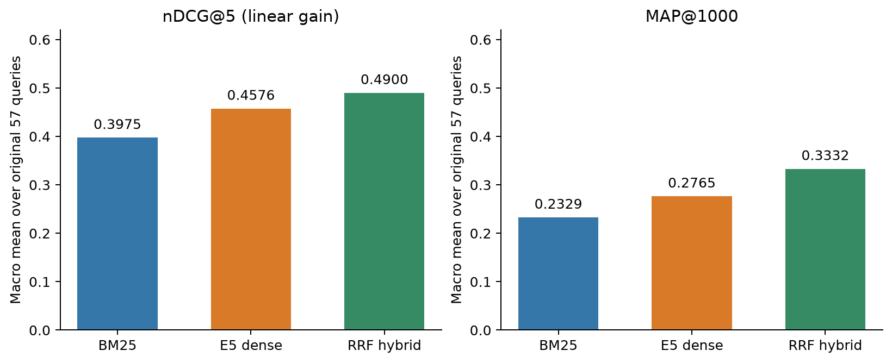

# News Retrieval under Vocabulary Mismatch: BM25, Dense Search and Linguistic Constraints
**Group:** 5 · **Course:** Information Retrieval  
**Faculty mentor:** Abhinav Kumar  
**Members:** Parth Raghuvanshi (2023A7PS0574P); Sushruth Reddy Challa (2023A7PS0504P); Hamsini G (2023A7PS0006P); Kritika Pandey (2023A7PS0022P)  
**GitHub repository:** https://github.com/parthRag/news-ir-bm25-dense-final (verified repository)

<div class="meta">Research implementation report · 25 October 2026 · Local reproducible artifacts</div>

## Abstract
We compare lexical BM25 and E5-base-v2 dense retrieval over 594,589 eligible news articles. Evaluation separates a 57-topic supplied-qrels benchmark from a 40-query stress suite covering vocabulary mismatch, negation, word sense and temporal constraints. The expanded custom evaluation uses 1,444 evidence-backed AI assessments of the equal-depth top-20 union for a preliminary comparison, with human review planned as the next validation stage. On the original benchmark, BM25, E5 and fixed reciprocal-rank fusion achieve nDCG@5 of 0.3975, 0.4576 and 0.4900. On the expanded custom suite, BM25 and E5 achieve nDCG@5 of 0.5133 and 0.4362, with pooled MAP@1000 of 0.4428 and 0.4072. Both query and topic-family difference intervals include zero. This reverses the initial 20 means; combined category behavior favors BM25 at nDCG@5, while E5 has higher word-sense pooled MAP. The follow-up was designed after initial outcomes were known. A bounded post-hoc empty-body filter raises E5 nDCG@5 to 0.5492. We supply a working local demo, independent native metric checks, explicit evidence provenance and reproducibility scripts. Findings are specific to these engines, queries, input budgets and incomplete relevance sets.

**Keywords:** information retrieval; BM25; dense embeddings; E5; negation; pooled evaluation; news search.

## 1. Introduction and research questions
News queries often describe a concept using vocabulary absent from a headline, but may also impose exact entities, polarity or event dates. A dense representation can bridge wording differences while blurring such constraints. A lexical ranker can reward the right names yet miss paraphrases or promote articles expressing the opposite assertion. Neither behavior should be assumed from the technology label alone.

We ask: **RQ1**, how do BM25 and E5 compare against supplied news judgments? **RQ2**, where do their relative rankings differ across four linguistic categories? **RQ3**, how much do empty records, duplicates, input truncation and assessment policy affect interpretation? **RQ4**, can the implemented system support transparent inspection and live demonstration on limited hardware?

The contribution is an implemented, auditable comparative study and a diagnostic query suite. It is not a new trained retrieval model. The supplied 57 topics provide a separate supporting benchmark; they cannot label the newly written information needs. The stress suite supplies assignment-specific evidence, with the assessment and validation plan in Section 5. The earlier proposal's hybrid and robustness ideas are retained as explicit extensions.


<!-- PAGE -->

## 2. Related work and retrieval foundations
### 2.1 Lexical ranking
Manning, Raghavan and Schütze [1] introduce term weighting and probabilistic retrieval foundations. BM25 rewards query-term occurrence with saturation and document-length normalization. It is attractive as a strong interpretable baseline, but a bag of analyzed terms does not encode argument structure, temporal arithmetic or truth conditions. Preserving a negation word merely makes it available for lexical matching.

### 2.2 Dense representations
E5 [2] learns text representations with contrastive training. We use the released E5-base-v2 checkpoint rather than training on this project. The model card [3] supplies the query/passage formatting, pooling and normalization procedure implemented here. Dense ranking compares vectors and can associate paraphrases, but representation similarity does not itself enforce all mandatory constraints. E5 is a bi-encoder, not an interactive generative answer system. Claims about its rankings should not be generalized to every LLM.

BEIR [4] motivates evaluation across varied retrieval settings and the continued use of strong lexical baselines. Our two reference sets serve different purposes: supplied background-linking relevance versus deliberately constrained news information needs. Their macro scores are not interchangeable and are never combined into one average.

### 2.3 Negation and fusion
NevIR [6] studies document pairs differing in negation and finds architecture-dependent weaknesses. It motivates testing polarity rather than predicting that every dense model will outperform BM25. Our natural news queries are not a replication of NevIR's controlled minimal-pair benchmark: they have multiple constraints and heterogeneous articles. Consequently, winning one negation query is not direct evidence of compositional negation understanding.

RRF [5] combines ranks without requiring comparable raw score scales. Our extension fixes the usual k=60 and equal engine weights, using no labels to fit fusion. Its empirical advantage is evaluated separately on the original 57 topics.

### 2.4 Assessment validity
Soboroff [7] discusses risks in treating model-generated relevance labels as ground truth. Our preliminary reference enables an initial engine comparison; human review is the next validation stage. Source hashes and literal quotations support inspection and reproducibility. Section 5 describes the assessment process and review plan; supplied benchmark judgments remain a separate evidence source.

All system conclusions are therefore conditional: the encoder, preprocessing, query design, available article text and reference labels jointly define the experiment. No causal account of an embedding's internal reasoning is inferred from a ranking alone.


<!-- PAGE -->

## 3. Corpus and query design
### 3.1 Corpus provenance and eligibility
The downloaded mirror is `liuqi6777/trec-news` [10]. The local corpus contains 594,977 JSONL records with string ID, title and text fields. Shared contents are `(title + newline + text).strip()`. Only 388 records empty in both fields are excluded from retrieval, leaving 594,589 eligible articles. All original IDs remain in the lookup store. The 15,984 title-only articles are retained in the baseline, because silently dropping them from one engine would change the comparison corpus.

The corpus SHA-256 is recorded in every index/run manifest. Source records are streamed into Lucene and a SQLite byte-offset table, avoiding another complete text copy. Both engines are validated against the same eligible IDs, not only an equal document count. Empty bodies and extraction artifacts remain visible, rather than being repaired with external web content. Source distribution rights must be checked before publishing corpus text; the code package excludes the corpus and article packets.

### 3.2 Supplied benchmark
The downloaded 57 queries are headline/background-linking topics. The 15,655 supplied qrel pairs were previously audited against the official NIST 2019 judgments [8]; the supplied 0–4 grades correspond to the official gain-valued form. Sixty topics exist in official metadata, but this local judged subset has 57. None of their canonical source-article IDs occurs in the local corpus, so there is no inferred source-document exclusion.

Sixty-five judgments refer to 57 unavailable article IDs, including three positive query–article pairs. Main evaluation retains them in reference denominators; a separate available-corpus sensitivity reuses unchanged rankings and removes those qrels. This avoids improving main scores merely by hiding unavailable positives.

### 3.3 Twenty linguistic information needs
Five queries each cover vocabulary mismatch (V01–V05), negation (N01–N05), word sense/homonyms (H01–H05) and temporal constraints (T01–T05). Each has inclusion, exclusion and graded-relevance rules. Queries use news-compatible needs, rather than transplanting movie or ancient-history examples into an unsuitable corpus. The exact queries and rubrics are frozen under `annotations/ai_study_v1/`; the original draft status field is preserved for hash compatibility, while the later protocol records the assessment method.

The suite includes workforce reductions, retirement reserves, cricket insects versus international sport, jaguar conservation, Apple’s device-unlocking dispute, and bounded event windows. A missing assertion never proves its negation. Event windows concern dates evidenced in article text, not guessed publication dates. The suite is small and intentionally difficult; it is not a random sample of user traffic. Appendix A supplies all twenty texts and inclusion rules; full exclusion rules remain in the versioned JSONL.


<!-- PAGE -->

## 4. System architecture and implemented retrieval
<div class="architecture"><svg xmlns="http://www.w3.org/2000/svg" viewBox="0 0 1000 270" role="img" aria-label="Shared corpus to BM25 and E5, saved runs, evaluation, demo and reports"><defs><marker id="a" markerWidth="8" markerHeight="8" refX="7" refY="4" orient="auto"><path d="M0 0L8 4L0 8" fill="#506c80"/></marker></defs><g font-family="Arial,sans-serif" font-size="14" fill="#16354b"><line x1="178" y1="135" x2="232" y2="135" stroke="#506c80" stroke-width="2" marker-end="url(#a)"/><line x1="412" y1="135" x2="458" y2="62" stroke="#506c80" stroke-width="2" marker-end="url(#a)"/><line x1="412" y1="135" x2="458" y2="200" stroke="#506c80" stroke-width="2" marker-end="url(#a)"/><line x1="650" y1="62" x2="700" y2="135" stroke="#506c80" stroke-width="2" marker-end="url(#a)"/><line x1="650" y1="200" x2="700" y2="135" stroke="#506c80" stroke-width="2" marker-end="url(#a)"/><line x1="846" y1="135" x2="880" y2="54" stroke="#506c80" stroke-width="2" marker-end="url(#a)"/><line x1="846" y1="135" x2="880" y2="135" stroke="#506c80" stroke-width="2" marker-end="url(#a)"/><line x1="846" y1="135" x2="880" y2="216" stroke="#506c80" stroke-width="2" marker-end="url(#a)"/><rect x="4" y="100" width="174" height="70" rx="7" fill="#eef3f6" stroke="#7491a5"/><text x="91.0" y="126.5" text-anchor="middle" dominant-baseline="middle">News corpus</text><text x="91.0" y="143.5" text-anchor="middle" dominant-baseline="middle">594,977 records</text><rect x="232" y="100" width="180" height="70" rx="7" fill="#eef3f6" stroke="#7491a5"/><text x="322.0" y="126.5" text-anchor="middle" dominant-baseline="middle">Shared title + body</text><text x="322.0" y="143.5" text-anchor="middle" dominant-baseline="middle">594,589 eligible</text><rect x="458" y="26" width="192" height="72" rx="7" fill="#eef3f6" stroke="#7491a5"/><text x="554.0" y="53.5" text-anchor="middle" dominant-baseline="middle">BM25 inverted index</text><text x="554.0" y="70.5" text-anchor="middle" dominant-baseline="middle">Full article</text><rect x="458" y="164" width="192" height="72" rx="7" fill="#eef3f6" stroke="#7491a5"/><text x="554.0" y="191.5" text-anchor="middle" dominant-baseline="middle">E5 → exact FAISS</text><text x="554.0" y="208.5" text-anchor="middle" dominant-baseline="middle">First 512 tokens</text><rect x="700" y="100" width="146" height="70" rx="7" fill="#eef3f6" stroke="#7491a5"/><text x="773.0" y="126.5" text-anchor="middle" dominant-baseline="middle">Saved top 1,000</text><text x="773.0" y="143.5" text-anchor="middle" dominant-baseline="middle">+ fixed RRF</text><rect x="880" y="16" width="116" height="68" rx="7" fill="#eef3f6" stroke="#7491a5"/><text x="938.0" y="41.5" text-anchor="middle" dominant-baseline="middle">57 original topics</text><text x="938.0" y="58.5" text-anchor="middle" dominant-baseline="middle">40 custom queries</text><rect x="880" y="101" width="116" height="68" rx="7" fill="#eef3f6" stroke="#7491a5"/><text x="938.0" y="126.5" text-anchor="middle" dominant-baseline="middle">Local demo</text><text x="938.0" y="143.5" text-anchor="middle" dominant-baseline="middle">+ full articles</text><rect x="880" y="182" width="116" height="68" rx="7" fill="#eef3f6" stroke="#7491a5"/><text x="938.0" y="207.5" text-anchor="middle" dominant-baseline="middle">Metrics, figures</text><text x="938.0" y="224.5" text-anchor="middle" dominant-baseline="middle">+ report</text></g></svg></div>

### 4.1 BM25 implementation
Pyserini 1.5.0/Lucene indexes the full shared article contents with English tokenization and lowercasing, no stemming, no stopword removal and no title boost. Fixed parameters are **k1=0.9, b=0.4**. Conceptually, the score is proportional to a sum of IDF-weighted saturated term frequencies:

`sum_t IDF(t) * tf(t,d) / (tf(t,d) + k1 * (1-b+b*len(d)/avg_len))`.

The implementation and independent score tests use Lucene's actual scoring conventions. Anserini's exported scores are rounded/adjusted for deterministic ordering; evaluation preserves the published rank order. A natural-language `NOT` is an analyzed term, not a hard Boolean operation; no hidden date filter is applied.

### 4.2 Dense implementation
The checkpoint is `intfloat/e5-base-v2`, revision `f52bf8ec8c7124536f0efb74aca902b2995e5bcd`. Inputs use `query: ` and `passage: ` prefixes, a total 512-token budget including prefix/special tokens, masked mean pooling and L2 normalization. Document vectors are 768-dimensional float32. Exact FAISS inner-product search over normalized vectors implements cosine ranking, without approximate-neighbor recall error.

Only the prefix of a long article is represented. BM25 sees full bodies, so shared corpus coverage does not mean equal text coverage. A pinned-tokenizer audit records retained character endpoints and visibility of every saved evidence span. It finds truncation in 568 of the initial 737 assessed pairs (expanded audit: 1,117 of 1,444); these are pair counts, not independent article counts or causal model explanations.

### 4.3 Fusion, manifests and lookup
Each engine exports up to 1,000 hits per query as JSONL and TREC files, alongside query snapshots, parameters and content hashes. RRF scores each unique ID by `sum(1/(60+rank))`, keeps 1,000 results and resolves score ties by ID. Original indexes/runs are never silently overwritten. The demo uses the same search CLI and a read-only article store; saved evaluation replay is labeled separately from new retrieval. On this Mac, JVM, model encoding and FAISS execution are isolated to avoid memory/OpenMP conflicts.


<!-- PAGE -->

## 5. Assessment protocol and evaluation definitions
### 5.1 Candidate pooling and reading
The current custom comparison uses full-article AI judgments as a preliminary reference. Human review is planned next and has not yet been completed. The review will begin with balanced cases across all 40 queries, independent overlap and adjudication, with achieved coverage reported before separate human-reviewed scores are produced. The detailed plan is in `reports/ASSESSMENT_METHOD.md`.

The union of each engine's top 20 contains 737 query–article pairs, including 188 in either top five. All 737 are assessed. Article packets use deterministic randomized order without engine, rank or score; however, earlier results had been seen, so perfect blindness and preregistration are not claimed. Every full available title/body was read, including long texts in explicit consecutive chunks. Only an exact repeated extraction glossary was removed from the reading display; evidence offsets always refer to original source contents.

Grades are **0** for failure of the information need or a mandatory constraint, **1** for limited detail while satisfying the need, and **2** for substantive directly relevant evidence. Each record includes rationale, literal quotations, Unicode start/end offsets, source hash, reading acknowledgment, assessor provenance and confidence. The distribution is 398 grade 0, 110 grade 1 and 229 grade 2; 625 decisions are self-rated high confidence, 112 medium. Confidence is not calibrated accuracy. Thirteen same-query exact-content reuses identify a source decision; no identical same-query contents have conflicting grades. Earlier pilot and top-five judgments are preserved.

### 5.2 Metrics
For cutoff K, `DCG@K = sum(gain_i/log2(i+1))`; `nDCG@K = DCG@K/IDCG@K`. Main gains equal grades: 0–4 for the original benchmark and 0–2 for custom queries. Exponential gains are a sensitivity analysis. IDCG uses all known reference positives, including positives absent from the retrieved ranks.

AP@1000 sums precision at each positively judged hit among the first 1,000 ranks, then divides by **all known relevant documents for the query**. MAP is the equal-weight macro mean. Binary relevance is grade > 0. P@5 divides by five, including when fewer results exist. Unjudged documents keep their ranks with zero contribution; this numerical convention is not a factual irrelevance judgment. Queries without known positives receive zero and stay in averages.

Custom MAP is explicitly **pooled MAP@1000**. Its reference set is the completed designated shallow pool, not exhaustive corpus labels. About 3% of the saved top-1,000 lists are judged. No claim of complete recall follows from complete assessment of top 20. V05's zero-positive pool does not prove there is no relevant corpus article.

### 5.3 Uncertainty and verification
Ten thousand paired query-bootstrap resamples produce descriptive percentile intervals, with recorded seeds. Related queries/shared articles and uncertainty in the preliminary reference limit interpretation. These are not label-accuracy intervals. Native `trec_eval` [9] independently cross-checks seven measures per query and macro mean. Ordinal scores preserve published rank order, including tied original scores, during those checks.


<!-- PAGE -->

## 6. Results on the original 57 topics
| Measure | BM25 | E5 dense | RRF k=60 |
| --- | --- | --- | --- |
| nDCG@5 | 0.3975 | 0.4576 | 0.4900 |
| MAP@1000 | 0.2329 | 0.2765 | 0.3332 |
| P@5 | 0.5298 | 0.5579 | 0.6421 |
| Recall@1000 | 0.6681 | 0.7738 | 0.8044 |

E5 has higher means than BM25, but BM25 wins 21 of 57 nDCG@5 comparisons; E5 wins 31 and five tie. The paired E5-minus-BM25 nDCG@5 difference is **+0.0601**, with descriptive 95% interval **[−0.0046, +0.1294]**. Its AP difference is **+0.0436**, interval **[+0.0032, +0.0852]**. These conditional estimates support complementarity rather than universal superiority.



RRF has the highest means. Its nDCG@5 difference against BM25 is +0.0926, interval [+0.0434, +0.1419]; against E5 it is +0.0324, interval [−0.0154, +0.0790]. AP differences are +0.1003 versus BM25 and +0.0567 versus E5, with positive descriptive intervals. Fixed fusion was not fitted on these qrels, but examining a third system remains exploratory rather than a new held-out confirmation.

### Judgment coverage and gain sensitivity
At rank five, judged fractions are **96.49% BM25**, **79.30% E5**, and **92.63% RRF**. Lower reference coverage can penalize genuinely useful unjudged results, especially for dense retrieval. It is incorrect to label every zero metric contribution a confirmed failure. Exponential-gain nDCG@5 is 0.3369/0.3959/0.4140; the NIST gain-valued sensitivity is 0.3546/0.4118/0.4369. Available-corpus sensitivity changes E5 to 0.4582, while BM25/RRF nDCG remain 0.3975/0.4900.

### Measured cases
For topic 870, E5's 0.9294 versus BM25's 0.0000 matches a contrast between reports of transgender killings and lexical distraction by political entities. Topic 830 similarly connects miniature frogs with a fingernail-sized description. Conversely, topic 852 favors BM25 (0.5353 versus 0.0457), but three dense top-five hits are unjudged; the observed difference mixes topical focus and coverage. These cases identify plausible explanations, not internal neural reasoning. Full IDs, supplied grades and inspected evidence remain in `reports/ORIGINAL_57_CASE_STUDIES.md`.


<!-- PAGE -->

## 7. Results on the custom linguistic suite
| Measure | BM25 | E5 dense |
| --- | --- | --- |
| nDCG@5 | 0.4621 | 0.4897 |
| nDCG@10 | 0.4634 | 0.5083 |
| Pooled MAP@1000 | 0.4006 | 0.4683 |
| P@5 | 0.5300 | 0.5300 |
| Judged fraction @1000 | 0.0299 | 0.0321 |

All 20 queries and all top-20 retrieved slots are judged. The only zero-positive pooled query is V05; V01 and T01 have relevant deeper results. Both systems have P@5=0.53, even though the ordering and grades of useful results differ.

| Category (5 each) | BM25 nDCG@5 | E5 nDCG@5 | BM25 pooled MAP | E5 pooled MAP |
| --- | --- | --- | --- | --- |
| Vocabulary mismatch | 0.1830 | 0.3488 | 0.1265 | 0.3630 |
| Negation | 0.6046 | 0.6192 | 0.6922 | 0.5409 |
| Word sense | 0.6341 | 0.7071 | 0.4165 | 0.6956 |
| Temporal | 0.4267 | 0.2836 | 0.3671 | 0.2738 |


**Uncertainty.** E5−BM25 nDCG@5 is +0.0275, interval [−0.1264,+0.1650], with 12 E5 wins, five BM25 wins and three ties. Pooled MAP difference is +0.0677, interval [−0.0877,+0.2220], with 12/7/1 wins/losses/ties. Both intervals include zero. Five hand-authored queries per category are insufficient for broad category-level significance claims.

The earlier top-five-only nDCG was 0.5149/0.5286. Deeper relevant judgments increase ideal-ranking denominators, changing nDCG despite identical original top-five grades and rankings. The frozen historical snapshot remains valid for its original scope. It must not be substituted for the current complete-designated-pool results merely because it is larger.

**Sensitivity.** Exponential 0/1/3 gains yield nDCG@5=0.4350/0.4708. Removing medium-confidence positive credit gives 0.4181/0.4645; keeping only grade-2 positives gives 0.3797/0.4332. These specified scenarios preserve the average direction but do not bound label error, establish significance or validate high-confidence judgments.


<!-- PAGE -->

## 8. Failure analysis: linguistic boundaries and competing explanations
### 8.1 Vocabulary mismatch
The category means favor E5, with nDCG@5=0.3488 versus 0.1830. V04 is a strong individual dense case, while V01 shows that finding workforce-cutting language is insufficient if the required technology sector or explanatory detail is missing. Both V01 top-five lists fail, yet the deeper pool has relevant articles. Better semantic association is helpful but does not enforce every constraint.

### 8.2 Negation
E5 wins three of five negation queries at nDCG@5, BM25 two. Means are close: 0.6192 versus 0.6046. The pooled MAP ordering reverses, with BM25 0.6922 versus E5 0.5409. Thus the answer depends on whether we ask about a few early graded hits or recovery of all known pooled positives. N03 is a strong BM25 case (0.6608 versus 0.1461). Retrieved reports can contain the right topic yet fail the required assertion. Mixed articles can still qualify when they explicitly describe the requested condition. Absence of an airborne-transmission assertion alone is not an explicit rejection of airborne transmission. These are judgments of what the requested reporting states, not current clinical guidance.

This does not prove BM25 understands negation: its bag-of-terms formulation has no truth-condition mechanism. Nor does an E5 win prove polarity understanding. Entity matches, correlated wording, input coverage, article quality and the query's other constraints remain competing explanations. A controlled polarity-flip study needs changed-query judgments and is future work.

### 8.3 Word sense and extraction quality
H02 asks about India international cricket results and player performance. Dense top-five results are empty-body records titled `Results`, all grade 0. BM25 also makes errors: its lead previews India–Pakistan rather than reporting a match result. Deeper candidates include wrong teams, domestic cricket and previews. H04 retrieves conservation articles about other species; H03 instead concerns Apple’s iPhone-unlocking dispute with the FBI. Correct broad context is insufficient for the precise entity/sense need.

### 8.4 Temporal constraints
BM25 leads temporal category means (0.4267 versus 0.2836 nDCG@5). T03 and T04 are prominent dense failures. Judgments distinguish actual state rulings from stayed decisions and the excluded national event. T01's deeper retrospectives can satisfy an earlier window even if the article itself is later. Undated relevant-looking text does not establish the requested bounded event date. One T01 retrospective contains a questionable relative date and has medium confidence; this is a source-quality limitation.

### 8.5 Evidence visibility
The audit records whether quoted support lies within E5's retained prefix. It can identify unavailable evidence, but visibility does not establish use by the model. BM25's full-body coverage and E5's prefix coverage confound architecture with input budget. Neither causal attribution to truncation nor a general model-family claim is warranted without a controlled equal-input or passage-indexing experiment.


<!-- PAGE -->

## 9. Post-hoc content-quality ablation
### 9.1 Protocol
After observing empty records and duplicate articles, we applied the same four deterministic policies to each engine's original top 20: retain all; remove whitespace-empty bodies; suppress exact title-plus-body duplicates after the first occurrence; apply both. Rankings preserve remaining original order, use no score/label threshold and never refill beyond rank 20. All candidates are already judged, so no unjudged replacement is silently treated as an observed negative. The baseline files and relevance labels remain unchanged.

Main nDCG uses the original document-level reference IDCG; P@5 always divides by five. MAP is not reported for these bounded candidate lists. Because repeated positively judged document IDs can receive repeated ordinary nDCG credit, we additionally report a separate **unique-content nDCG@5**: only the first occurrence of a content hash earns gain, duplicate positions remain, and IDCG uses all unique pooled contents. Same-query content grades are consistent. This additional measure is not standard document-level nDCG and cannot be compared numerically as if it used the same reference.

| Rule within original top 20 | BM25 nDCG@5 | E5 nDCG@5 | BM25 P@5 | E5 P@5 |
| --- | --- | --- | --- | --- |
| Frozen baseline | 0.4621 | 0.4897 | 0.5300 | 0.5300 |
| Remove empty bodies | 0.4621 | 0.5492 | 0.5300 | 0.6000 |
| Exact content deduplication | 0.4664 | 0.5053 | 0.5300 | 0.5600 |
| Both rules | 0.4664 | 0.5434 | 0.5300 | 0.6000 |

### 9.2 Interpretation
Empty-body removal improves E5 nDCG@5 by **+0.0595** and P@5 by **+0.07**, with BM25 unchanged. H02 rises from 0 to 0.4788 within the retained horizon. N03 improves from 0.1461 to 0.3601 but remains below BM25's baseline. This demonstrates sensitivity to available-record quality; it does not establish that empty records fully explain polarity failures.

Unique-content nDCG rises with exact deduplication: BM25 **0.4581 → 0.4736**, E5 **0.4821 → 0.5153**. Both rules yield **0.4736 / 0.5534**. Ordinary E5 nDCG with both rules (0.5434) is slightly lower than empty-body removal alone (0.5492), while the unique-content measure improves. The difference reflects what each reference rewards and illustrates why diversity cannot be inferred from document-ID metrics alone.

These rules were motivated by observed failures, not preregistered or validated on a fresh test set. No optimal threshold was searched, but post-hoc selection still limits generalization. The experiment measures filtering within a depth-20 horizon, not reindexing/searching a cleaned full corpus. Future work should test the frozen rule on new queries, include longer refilling pools with proper labels, and compare passage representations while controlling input coverage.

Outputs include every candidate/retained ID, per-query CSV, aggregate metrics and source-bound hashes in `artifacts/evaluations/quality-top20-v1/`.


<!-- PAGE -->

## 10. Engineering, efficiency and reproducibility
### 10.1 Resource measurements
| Component | Measured requirement or time | Interpretation |
| --- | --- | --- |
| BM25 index folder | 385,483,844 bytes (367.6 MiB) | Includes local lookup metadata; disk, not RAM |
| Dense index folder | 1,848,335,569 bytes (1.72 GiB) | Excludes separate model weights |
| E5 weights | About 418 MiB | Additional disk requirement |
| BM25 index build | 66.55 seconds, local Mac | Different stage/hardware from encoding |
| Full dense job | 20,574.8 seconds, Kaggle T4 | About 5 h 43 min, including job work |
| RRF computation | About 0.69 ms/query | Saved rank fusion only, excluding searches/startup |
| Live CPU smoke query | BM25 1.39 s; E5 48.59 s | Includes separate process/model startup; single-run observation |

The local machine has 8 GiB RAM. GPU document encoding used one T4 and checkpointed float32 shards, which were validated for complete unique IDs, finite normalized vectors and source/model identity. It is completed work; the demo needs no GPU. Peak resident RAM and representative warmed query-latency distributions have not been measured under a controlled protocol. Disk sizes are not substitutes for RAM measurements, and disparate build stages are not a speedup comparison.

### 10.2 Working demo
A standard-library local HTTP server serves packaged HTML/CSS/JavaScript. Startup verifies query/run/evaluation hashes and corpus identity. Saved custom views show two engines, relevance rules, per-query metrics, full articles, rationale and highlighted evidence. The input toggle displays the exact E5-retained passage text. Original views additionally show RRF and supplied grades.

Live searches run BM25 then E5 in separate processes, combine complete top-1,000 lists by RRF, and return explicitly unjudged results without fabricated metrics. FAISS remains isolated. One job at a time, bounded in-memory history, literal query arguments and subprocess timeouts support operation on the limited machine. Saved comparisons remain available during live retrieval and are never overwritten.

### 10.3 Checks and artifact integrity
The initial release had 140 passing tests (the expanded suite is reported in Section 13), covering real Lucene behavior, independent scoring, Unicode offsets, malformed inputs, atomic publication, source identity, retrieval exports, metric definitions, assessment preservation, exact-content handling, HTTP routes, live-job recovery and quality-metric behavior. Initial-release native checks total **5,460**: 3,248 original baseline comparisons, 1,624 RRF comparisons and 588 custom comparisons. Native four-decimal output uses tolerance 0.000051. The custom artifact validator recomputes saved scores and checks all 737 source/evidence records. Real-browser verification covers all 77 saved queries, article views, 390-pixel layout and actual BM25/E5/RRF retrieval, with no observed JavaScript exceptions.


<!-- PAGE -->

## 11. Limitations, conclusions and remaining review
### 11.1 Validity limits
**Assessment.** The current reference supports preliminary comparison. Full-text evidence and self-rated confidence help inspection, but do not establish decision accuracy; earlier outcomes were also visible during study development. The planned human-review stage will check relevant cases, hard negatives, temporal bounds and borderline grades. Review coverage and agreement will be reported only after that work is completed.

**Pooling.** Completing the designated pool does not label the whole corpus. Only about 3% of each top-1,000 list is judged. Custom AP/recall depend on pooled known positives; V05's zero cannot establish answer absence. RRF is evaluated on original supplied qrels only. A custom RRF run could promote articles outside the judged top-20 union, so a comparable custom evaluation would require attention to additional coverage.

**Comparability.** Both engines share article IDs, but BM25 sees full bodies and E5 only a prefix. The exact search removes approximate-index error but not encoder truncation. Extraction glitches, title-only records and exact duplicates interact with representation. The bounded post-hoc quality experiment demonstrates sensitivity without fully separating these causes.

**Generalization.** The initial twenty authored queries, five per category, were too few for broad claims about linguistic competence. Query dependence and model-specific behavior limit bootstrap interpretation. No held-out tuning set, new dataset or controlled polarity-pair benchmark was added. Original supplied judgments also have unequal coverage and a small number of unavailable positives.

A separate extension now defines **40 queries, ten per category**, preserving the original 20 exactly and adding 20 new information needs. Assessment and evaluation are now complete; Sections 12–13 report the added and combined samples. Sections 7–9 preserve the initial 20 results and ablations. The extension was designed after viewing those results and is not an independent held-out study. Shared-topic families are recorded for grouped uncertainty analysis. Its frozen rubrics and protocol are in `annotations/custom40_v2/`; see `reports/CUSTOM_40_EXTENSION.md`.

**Efficiency.** One GPU encoding job and a few cold local searches do not supply a controlled systems benchmark. End-to-end latency includes startup and memory pressure; peak RAM is unmeasured. The demo is a local research prototype, not a deployed concurrent service.

### 11.2 Initial-study interpretation
The initial 20-query comparison shows complementary strengths under transparent evaluation. E5 improves original-benchmark averages and performs well on vocabulary mismatch and word sense; BM25 retains substantial per-query wins and stronger temporal category means. Negation has no simple technology-level winner: near-top graded retrieval and pooled recovery can favor different engines. Fixed RRF improves original averages, while uncertainty and judgment coverage qualify the claim. Article-quality filtering materially changes dense outcomes, supporting explicit data-quality diagnosis alongside model analysis.

The deliverable combines a functioning dual-engine system, a 40-query challenge suite, complete designated-pool judgments, nDCG/MAP evaluation, evidence-linked failures, uncertainty, a measured stretch experiment and a local demo. The preliminary comparison is complete, with the human-review stage planned as described above.

### 11.3 Submission and authorship
Group 5 member and mentor details appear on the first page. The brief records responsibility for completed team components; actual personal work is confirmed separately. The verified public repository, linked on page 1, publishes source, notebooks, preprocessing scripts and reports. Assessment provenance and the next validation stage are described in Section 5. Submit the four-page brief; this longer report is supporting research material.


<!-- PAGE -->

## References and reproduction index
1. Manning, Raghavan and Schütze (2008). *Introduction to Information Retrieval*. Cambridge University Press. Chapters 6 and 11. https://nlp.stanford.edu/IR-book/
2. Wang et al. (2022; revised 2024). *Text Embeddings by Weakly-Supervised Contrastive Pre-training*. https://arxiv.org/abs/2212.03533
3. intfloat. *E5-base-v2 model card*. https://huggingface.co/intfloat/e5-base-v2
4. Thakur et al. (2021). *BEIR: A Heterogenous Benchmark for Zero-shot Evaluation of Information Retrieval Models*. https://arxiv.org/abs/2104.08663
5. Cormack, Clarke and Büttcher (2009). *Reciprocal Rank Fusion outperforms Condorcet and individual Rank Learning Methods*. SIGIR. https://cormack.uwaterloo.ca/cormacksigir09-rrf.pdf
6. Weller, Lawrie and Van Durme (2024). *NevIR: Negation in Neural Information Retrieval*. EACL, pp. 2274–2287. https://aclanthology.org/2024.eacl-long.139/
7. Soboroff (2025). *Don't Use LLMs to Make Relevance Judgments*. Information Retrieval Research 1, 29–46. https://tsapps.nist.gov/publication/get_pdf.cfm?pub_id=958495
8. NIST. *TREC 2019 News track data*. https://trec.nist.gov/data/news2019.html
9. NIST. *trec_eval source*. https://github.com/usnistgov/trec_eval
10. Dataset mirror used locally: https://huggingface.co/datasets/liuqi6777/trec-news


### Reproduction commands
Use Python 3.12 and Java 21. In the existing environment, from the repository root:

```sh
.venv/bin/python -m news_ir.demo
.venv/bin/python -m pytest -q
.venv/bin/python scripts/validate_custom_depth20.py
.venv/bin/python scripts/evaluate_quality_ablation.py --output artifacts/evaluations/quality-recheck
.venv/bin/python scripts/build_final_documents.py
```

The locked environment and `README.md` document setup, source/index construction, Kaggle encoding, independent evaluation and saved-run reproduction. `reports/DEMO_GUIDE.md` provides the presentation sequence. `DELIVERABLES.md` maps submission artifacts and local data dependencies.

**Provenance anchors.** Corpus SHA-256: `82086c5dc9397700ca6682d19f1a1cace8ace5defa31f7990ca3c28314ec61a9`. Custom queries: `2ba74dbfb53f1d69e17aade424d9cfabc32fcb4443533b37661c477987c32a77`. Custom assessments: `d23c2fbd4b0b85f49420a0d65a4af1e7da19eb4eb9418a1da212aefecbc52536`. Full revision/configuration hashes remain in manifests; frozen inputs are not modified to regenerate the report.

**Evidence location.** The 737-decision appendix is `reports/CUSTOM_20_DEPTH20_EVIDENCE.md`; full article packets remain local under `artifacts/assessments/`. The longer appendix is not reproduced in the four-page brief. Selected article excerpts remain evidence for the judgments, rather than a substitute for full-document review.


<!-- PAGE -->

## 12. Expanded scope: 40-query follow-up and combined results
This section supersedes the initial-20 interpretation in Sections 7–8. Those tables and the quality ablation remain unchanged historical results. We added five information needs per category without altering the original queries, rankings or 737 decisions. The follow-up was designed after observing initial results; it is not a preregistered or independent held-out test. All new rubrics were frozen before follow-up retrieval. No model retraining or test-driven parameter tuning was performed.

| Evaluation set | BM25 nDCG@5 | E5 nDCG@5 | BM25 MAP | E5 MAP |
| --- | --- | --- | --- | --- |
| Original 57 supplied qrels | 0.3975 | 0.4576 | 0.2329 | 0.2765 |
| Initial custom 20 | 0.4621 | 0.4897 | 0.4006 | 0.4683 |
| Added custom 20 | 0.5645 | 0.3828 | 0.4849 | 0.3460 |
| Combined custom 40 | 0.5133 | 0.4362 | 0.4428 | 0.4072 |

| Category (10 each) | BM25 nDCG@5 | E5 nDCG@5 | BM25 MAP | E5 MAP |
| --- | --- | --- | --- | --- |
| Vocabulary mismatch | 0.4757 | 0.4000 | 0.4007 | 0.3343 |
| Negation | 0.7270 | 0.6322 | 0.6767 | 0.5469 |
| Word sense | 0.5526 | 0.5198 | 0.4113 | 0.5389 |
| Temporal | 0.2980 | 0.1930 | 0.2823 | 0.2085 |

The added 20 favor BM25 strongly enough to reverse both combined mean measures. The initial advantage of E5 on vocabulary mismatch and word sense is therefore not stable across this authored sample. BM25 leads all four combined category nDCG means, while E5 retains higher word-sense pooled MAP. Combined P@5 is **0.555 BM25 / 0.460 E5**. Per-query nDCG wins are **21 BM25 / 15 E5 / 4 ties**. The result does not show that lexical retrieval generally solves semantic mismatch: long queries contain useful matching terms, constraints differ, and the E5 representation has a shorter input budget.

Assessment now covers **1,444 pairs**, including **707 added decisions**. Four disjoint assessment batches used the protocol in Section 5; no agreement score is inferred from this division. Every unique available article in each assignment was read; exact same-query/full-content duplicates could reuse a documented decision. A targeted primary-assistant audit reviewed five borderline cases before metrics and downgraded one Japanese evacuation-advice judgment because issuance after March 11 was not established. Original category files and the audit trail are retained. All 737 initial decisions are byte-preserved.

Temporal judgments require article-supported event dates. A report of a Brazilian deployment on “Saturday” without a calendar anchor can be topically appropriate but fail this evidence requirement. Such zeros should not all be interpreted as wrong-event retrieval. Relevance concerns the article's assertions and the frozen need; it does not certify every factual assertion in the source.


<!-- PAGE -->

## 13. Robustness of the expanded comparison
The all-40 E5−BM25 mean differences are **−0.0771 nDCG@5** and **−0.0356 pooled MAP**. We retain the initial query-bootstrap analysis and add paired topic-family resampling to avoid treating the cricket, Java and Mercury sense pairs as fully independent topics. Each resampled family carries all its queries; the ratio of summed differences to the resampled query count preserves the query-weighted estimand.

| Resampling unit | nDCG@5 95% interval | Pooled MAP 95% interval |
| --- | --- | --- |
| 40 queries | [-0.1703, +0.0148] | [-0.1301, +0.0609] |
| 37 design families | [-0.1729, +0.0150] | [-0.1315, +0.0588] |
| 35 broader topic groups | [-0.1767, +0.0212] | [-0.1362, +0.0678] |

All intervals include zero. The broader grouping additionally joins marriage-law and Ebola topics across categories. Neither grouping guarantees independent topic families; the intervals describe resampling variability, not judgment accuracy or generalization to an external query population. Category groups contain ten queries each and remain exploratory. Gain and confidence sensitivities are saved alongside each evaluation.

**Coverage and reproducibility.** Both engines' complete top 20 are judged. Mean judged fraction at 1000 is **2.9175% BM25 / 3.1500% E5**. Custom MAP remains incomplete-pool MAP; higher recall of pooled positives does not demonstrate corpus-wide completeness. V05 remains the sole zero-positive pool. Combined saved runs concatenate unchanged component ranks and scores, with component manifest hashes. Earlier E5 query encoding ran on a GPU, while follow-up query encoding used the CPU; combined timing is not a controlled benchmark. The document vectors, model revision and corpus remain the same.

**Concrete follow-up cases.** For V08, BM25 nDCG@5 is **0.9270**, E5 **0.3008**. BM25's first article (`5b0dbbda-5c3e-11e7-9fc6-c7ef4bc58d13`, grade 2) connects wealthy arrivals, rising rents and forced moves in Bloomingdale; E5's first (`d056a7e2-f5df-11e5-8b23-538270a1ca31`, grade 0) contains only a link to earlier columns. That is an article-content failure as well as a ranking observation. For N08, BM25's lead (`d29a85bb3643b94fb5ad7fb7bc77a1a4`, grade 2) explains completed Keystone rejection, while E5's lead (`8d3f8976-41f0-11e1-8f2d-87a67739d0d2`, grade 0) predicts an announcement later that day: the decisive constraint is completed versus pending action. V07 is a counterexample: E5 leads **0.3392 vs 0.3156**, with a detailed D.C. risk-assessment article at rank 1; BM25's first discusses cash bail without establishing the required alternative. These evidence-backed distinctions describe observed rankings, without proving a causal model mechanism.

**Validation.** Added and combined metrics contribute **588 + 1,148** independent native comparisons, giving **7,196** across the project. The current test suite has **153 passing tests**. The expanded report, saved demo, all 40 frozen query texts, 1,444 decisions, targeted adjudication, source-run lineage and uncertainty artifacts are included in the local package. Full article packets, corpus, model and indexes are excluded from the portable archive and remain local dependencies.

**Next validation stage.** Human review is planned, starting with a balanced sample of positives, hard negatives and date-unsupported cases. After review, we will test passage-based or equal-input retrieval with fresh judgments. Controlled polarity pairs would isolate negation better than these natural multi-constraint queries. The larger suite supplies more diagnostic cases, while the reversal warns against assuming a model-level winner from the first five examples per category.


<!-- PAGE -->

## Appendix A. Frozen custom queries (V01–N05)

Each information need has the shared 0/1/2 rubric: fails a mandatory constraint; limited qualifying detail; substantive qualifying evidence. Exact exclusion rules and status/protocol fields are in the frozen JSONL. Temporal grading requires article-evidenced event bounds.

| ID | Query text | Inclusion rule |
| --- | --- | --- |
| V01 | Find news about workforce reductions at technology firms, explaining why employees lost their positions and how many were affected. | Technology-sector layoffs or job cuts, with reasons or scale. |
| V02 | How could depletion of the U.S. old-age insurance reserve affect retirees’ monthly payments? | U.S. Social Security retirement trust-fund depletion and consequences for benefits. |
| V03 | Find reporting on repeated blows to the head in professional American football and lasting damage to memory and thinking. | Repeated football head trauma and long-term cognitive impairment, including CTE. |
| V04 | What practical arrangements help older adults keep living in their own houses as their mobility declines instead of moving into residential care? | Aging in place with practical housing adaptations, assistance or support for declining mobility. |
| V05 | Find reports about verifying an airline passenger’s identity using facial features or fingerprints in place of conventional boarding documents. | Airport or airline biometric identity/boarding systems using face or fingerprint recognition. |
| N01 | Find studies that did NOT find a decline in employment after Seattle increased its minimum wage, including the evidence behind that conclusion. | An empirical Seattle minimum-wage study explicitly reporting no employment decline, with findings/method evidence. |
| N02 | Find U.S. court decisions that did NOT uphold bans on same-sex marriage and instead allowed same-sex couples to marry. | Court rulings striking down or refusing to uphold marriage bans and permitting marriage. |
| N03 | Find reporting explaining that Ebola is NOT airborne and describing the direct-contact conditions through which transmission occurs. | Explicit rejection of airborne spread alongside an explanation of direct-contact transmission. |
| N04 | Find reports of research concluding that vaccines do NOT cause autism, including the evidence used to reject the claimed connection. | Research or evidence explicitly rejecting a causal vaccine-autism link. |
| N05 | Find reports confirming that George Zimmerman was found NOT guilty in the shooting of Trayvon Martin, excluding predictions made before the verdict. | Reports confirming the actual acquittal and identifying the Zimmerman/Martin case. |

**Scope:** All pairs in the BM25/E5 top-20 union are assessed, with full-available-text evidence. Query labels are not transferred from the original 57 topics. Hard constraints remain part of the relevance decision; topically related contradictory or undated articles do not automatically qualify.

<!-- PAGE -->

## Appendix A. Frozen custom queries (H01–T05)

Each information need has the shared 0/1/2 rubric: fails a mandatory constraint; limited qualifying detail; substantive qualifying evidence. Exact exclusion rules and status/protocol fields are in the frozen JSONL. Temporal grading requires article-evidenced event bounds.

| ID | Query text | Inclusion rule |
| --- | --- | --- |
| H01 | Find reporting on cricket farming for human food, including nutritional benefits or environmental costs. | Cricket insects bred/consumed as food with nutrition or environmental evidence. |
| H02 | Find reports of international cricket matches involving India that explain match results and player performances. | The sport: an international match involving India, with a result or performance account. |
| H03 | Find reporting on Apple’s dispute with the FBI over unlocking the iPhone involved in the San Bernardino investigation. | Apple the technology company, FBI device access and the San Bernardino case. |
| H04 | Find news about jaguar conservation and habitat loss in the Americas, focusing on the animal’s survival. | Jaguar the animal: conservation, habitat threats or survival in the Americas. |
| H05 | How did Federal Reserve interest-rate decisions affect bank lending and borrowing costs? | Bank as a financial institution, with a connection between Fed interest rates and lending/borrowing. |
| T01 | Find events in the United Kingdom during the first 30 days after the June 23, 2016 vote to leave the European Union. | A substantive UK event dated June 24–July 23, 2016, connected to the referendum aftermath. |
| T02 | Find actions taken by U.S. authorities in the first seven days after the April 15, 2013 Boston Marathon bombings. | An actual authorities’ action dated April 16–22, 2013 and connected to the Boston bombings. |
| T03 | Find state-level changes to U.S. same-sex marriage laws from January 1, 2013 through June 25, 2015, before the Supreme Court’s nationwide ruling. | An actual state-level legal change effective/decided in the stated inclusive window. |
| T04 | Find U.S. public-health responses in the first 60 days after the September 30, 2014 announcement of the first Ebola diagnosis in the United States. | A U.S. public-health response dated October 1–November 29, 2014, connected to that diagnosis/outbreak. |
| T05 | Find developments in U.S.–Cuba relations after the December 17, 2014 normalization announcement but before the July 20, 2015 embassy reopenings. | A development dated December 18, 2014–July 19, 2015, in normalization of U.S.–Cuba relations. |

**Scope:** All pairs in the BM25/E5 top-20 union are assessed, with full-available-text evidence. Query labels are not transferred from the original 57 topics. Hard constraints remain part of the relevance decision; topically related contradictory or undated articles do not automatically qualify.

<!-- PAGE -->

## Appendix B. Traceable failure-analysis evidence

These selected saved assessments connect the discussion to exact article IDs and literal source text. The grades evaluate the frozen query need, not the scientific or legal truth of every article assertion. Full rationales, all evidence offsets and source hashes remain in the 737-decision appendix.

| Query / saved rank / grade | Document ID, quotation and assessment rationale |
| --- | --- |
| V04 · E5 rank 1 · grade 2 | `2f33cb3e-46a6-11e1-865e-8d7745453554` — “seniors who are eschewing nursing homes in favor of independent living” — Detailed aging-in-place services include senior transport, fall-prevention devices and medication support, with examples of people unable to drive who avoid nursing homes. |
| N03 · BM25 rank 2 · grade 2 | `6e21bdec-561b-11e4-809b-8cc0a295c773` — “Ebola in humans is spread only through direct contact with virus-laden bodily fluids” — Despite discussing speculative future mutation, the full article explicitly rejects present airborne transmission and explains direct contact with virus-laden fluids, including the Dallas nurses. |
| N03 · E5 rank 1 · grade 0 | `48ba826e85ce81d1399fc6636b1e8c23` — ““Limited airborne transmission of Ebola is ‘very likely,'” new study says” — The available record is a headline asserting likely limited airborne transmission and a short attribution stub. |
| H02 · BM25 rank 1 · grade 0 | `0731a894-b080-11e4-bf39-5560f3918d4b` — “when Pakistan and India meet for their first game” — Primarily previews India-Pakistan and tournament rivalries before play. |
| H02 · E5 rank 1 · grade 0 | `614571525868fac3ac742d8699e9c7b6` — “Results” — Exact duplicate of the one-word Results record with empty body, not a cricket match report. |
| T03 · BM25 rank 1 · grade 2 | `ee0edaf8-9513-11e4-aabd-d0b93ff613d5` — “remain legal in the majority of states through 2015” — Detailed Florida state-level licensing change is bounded to the New Year period before the coming June decision, with the text explicitly discussing legality through 2015. |
| T03 · E5 rank 1 · grade 0 | `cd2d15a93cdce9a5bdec350e450afcfe` — “These maps show just how much the landscape has changed recently” — Timeline/chart introduction says the country changed after 2013, but the maps and concrete state events are absent from the extracted record. |

V04 demonstrates a qualifying dense hit, not a failed lexical lead: BM25 rank 1 is also grade 2, while its lower early ranks explain the query-level difference. For N03, the BM25 positive above has support far beyond the E5 prefix; lexical specificity and coverage remain competing explanations. For T03, a qualifying date must be established from the full narrative; the brief quotation alone is not sufficient temporal proof.

<!-- PAGE -->

## Appendix C. Frozen follow-up queries (V06–N10)

Each new query uses the same strict 0/1/2 rubric. Wording and bounds were frozen before retrieval; frozen pending-status fields are historical, with completion recorded separately.

| ID | Query text | Inclusion rule |
| --- | --- | --- |
| V06 | Find reports about hospitals whose computer files were locked by attackers demanding payment to restore access. | A hospital or healthcare provider suffered a ransomware incident: files or systems were encrypted or locked and payment was demanded to restore access. |
| V07 | Find reports on replacing money paid to leave jail before trial with assessments of whether defendants will return to court. | A concrete implemented or proposed pretrial reform replaces or reduces cash bail and uses a risk assessment that considers court appearance. |
| V08 | Find reports about longtime neighborhood residents being pushed out as wealthier newcomers move in and rents rise. | A specific neighborhood or community links wealthier incoming residents and rising housing costs to displacement or a documented threat of displacement of existing residents. |
| V09 | Find reports about companies moving their legal home or booking profits abroad to reduce taxes owed in their home country. | A company shifts profits or corporate tax residence across borders with an explicitly stated purpose or consequence of reducing home-country corporate tax. |
| V10 | Find reports about school pupils unable to finish internet-based homework because their homes lack reliable online access. | School-age pupils face a homework barrier caused by unavailable, unaffordable or unreliable home internet; reports on responses qualify if they explain this barrier. |
| N06 | Find reports explaining that research did NOT establish that playing violent video games causes real-world violent crime. | The article explicitly reports an absence of established causal evidence connecting violent video-game play to real-world violent crime; distinctions from short-term aggression qualify when the violent-crime claim is addressed. |
| N07 | Find reports stating that Malaysia Airlines Flight MH370 had NOT been located despite search efforts or discoveries of possible debris. | The article explicitly states that the missing aircraft or its main wreckage had not been located at the time described, and discusses search efforts or debris evidence. |
| N08 | Find reports about the Obama administration NOT approving the Keystone XL cross-border permit and instead rejecting it. | A completed Obama-administration decision rejects the Keystone XL cross-border permit; the rejection must be explicit. |
| N09 | Find reports explaining that antibiotics do NOT treat viral infections and discussing why they are still prescribed for them. | The article explicitly distinguishes viruses from bacteria, states antibiotics do not treat viral infections, and discusses prescribing or misuse for viral illness. |
| N10 | Find reports explaining why the FBI did NOT recommend criminal charges against Hillary Clinton in its private-email-server investigation. | The article explicitly reports the FBI recommendation against criminal charges in the Clinton private-email-server case and supplies the stated reason. |

<!-- PAGE -->

## Appendix C. Frozen follow-up queries (H06–T10)

Each new query uses the same strict 0/1/2 rubric. Wording and bounds were frozen before retrieval; frozen pending-status fields are historical, with completion recorded separately.

| ID | Query text | Inclusion rule |
| --- | --- | --- |
| H06 | Find reports about security vulnerabilities in Java software and efforts to patch or disable it. | Java means the software platform or programming language; an actual vulnerability and a patch, mitigation or disabling response are discussed. |
| H07 | Find reports about volcanic eruptions on the Indonesian island of Java that caused evacuations or disrupted travel. | Java means the Indonesian island; a volcanic eruption there causes evacuations or travel disruption. |
| H08 | Find reports discussing astronauts or missions in NASA's Mercury human spaceflight program. | Mercury refers to the NASA human spaceflight program and the article substantively discusses its astronauts or missions. |
| H09 | Find reports about mercury contamination in fish or drinking water and the public-health response. | Mercury means the chemical element; fish or drinking water contamination and an actual warning, advisory, regulatory action or other public-health response are discussed. |
| H10 | Find reports about teachers going on strike over pay or working conditions and the effects on schools. | Strike means a teacher labor stoppage over pay or working conditions; the article discusses effects on schools or pupils. |
| T06 | Find emergency-response actions in Japan during the first 14 days after the March 11, 2011 earthquake and tsunami. | A completed emergency-response action by Japanese authorities or responders in Japan addressing the earthquake, tsunami or resulting nuclear emergency. The action must occur during 2011-03-12–2011-03-25, inclusive, with its event date supported by the article text. |
| T07 | Find security or investigative actions taken by French authorities during the first 14 days after the November 13, 2015 Paris attacks. | French authorities carry out a security, policing or investigative action in response to the November 13 Paris attacks. The action must occur during 2015-11-14–2015-11-27, inclusive, with its event date supported by the article text. |
| T08 | Find U.S. federal immigration-policy measures announced during the first 30 days after Donald Trump's January 20, 2017 inauguration. | The U.S. federal administration formally announces, signs or issues a specific immigration-policy measure; the announcement or issuance is the dated target event. The action must occur during 2017-01-21–2017-02-19, inclusive, with its event date supported by the article text. |
| T09 | Find actions Volkswagen took during the first 30 days after the EPA's September 18, 2015 diesel-emissions violation notice. | Volkswagen takes a concrete corporate response to the emissions scandal, such as an admission, apology, leadership change, sales suspension or formally announced remediation plan. The action must occur during 2015-09-19–2015-10-18, inclusive, with its event date supported by the article text. |
| T10 | Find public-health actions in Brazil during the first 30 days after the WHO's February 1, 2016 Zika-linked emergency declaration. | Brazilian authorities or public-health responders take a specific action in Brazil addressing Zika or its linked neurological or congenital risks. The action must occur during 2016-02-02–2016-03-02, inclusive, with its event date supported by the article text. |
