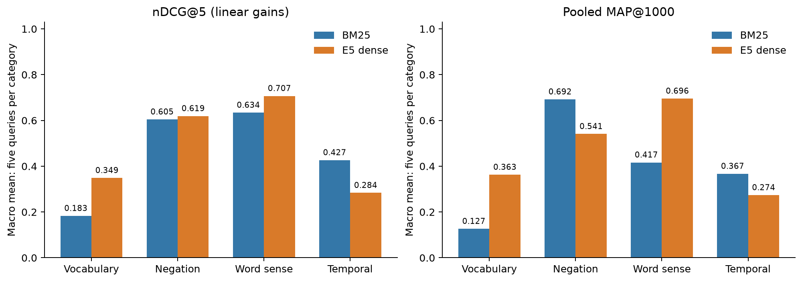
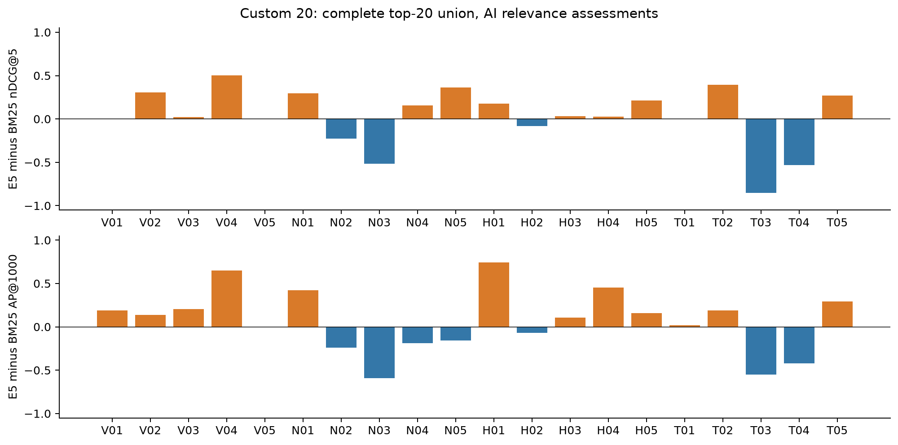

# Custom 20: complete pooled assessment

> Historical milestone: current assessment status and planned human review are described in [Assessment method](ASSESSMENT_METHOD.md).

All **737 query–article pairs** in the union of BM25 and E5's top 20 are assessed. This adds **549** decisions to the preserved 188-pair top-five snapshot. Every record has a 0–2 grade, rationale, confidence, exact Unicode evidence offsets, full-available-text reading acknowledgment and source hash. These full-article AI judgments support a preliminary comparison; human review is the next planned validation stage, as described above. The frozen queries, retrieval runs and original 57-query qrels are unchanged.

## Quantitative results

Macro means include all 20 queries, including V05 with no known relevant pool article. Saved runs contain up to 1,000 results per query; judgments cover every top-20 result, not all 1,000.

| Measure | BM25 | E5 dense |
| --- | ---: | ---: |
| nDCG@5, linear 0–2 | 0.462126 | 0.489668 |
| nDCG@10 | 0.463366 | 0.508320 |
| Pooled MAP@1000 | 0.400600 | 0.468318 |
| Precision@5 | 0.530000 | 0.530000 |
| Precision@10 | 0.495000 | 0.520000 |
| Recall@1000 of known pool positives | 0.832903 | 0.900871 |
| Judged fraction at 20 | 1.000000 | 1.000000 |
| Judged fraction at 1,000 | 0.029900 | 0.032100 |

**Interpretation:** AP divides by all known positive judgments in the complete designated pool. Unjudged hits retain their original rank and contribute zero to the calculation; they are not confirmed irrelevant. The depth-20 pool is shallow relative to 594,589 eligible articles, so these MAP/recall estimates cannot establish exhaustive corpus effectiveness. V05's zero score means no qualifying match was found in this pool, not that the corpus has no answer.

## What changed from the top-five snapshot

The earlier [188-pair result](CUSTOM_20_TOP5.md) remains a historical snapshot. Its nDCG@5 was 0.514902 / 0.528590. Deeper judgments discover more highly relevant articles and enlarge the ideal-ranking denominator, so current nDCG falls even though every original top-five grade and ranking is unchanged. Precision@5 remains 0.53 for both. V01 and T01 now have known deeper positives; V05 remains the only zero-positive pool query.

| Category | BM25 nDCG@5 | E5 nDCG@5 | BM25 pooled MAP | E5 pooled MAP |
| --- | ---: | ---: | ---: | ---: |
| Vocabulary mismatch | 0.183042 | 0.348797 | 0.126510 | 0.362959 |
| Negation | 0.604625 | 0.619174 | 0.692245 | 0.540907 |
| Word sense | 0.634115 | 0.707054 | 0.416519 | 0.695610 |
| Temporal | 0.426722 | 0.283645 | 0.367127 | 0.273797 |



## Paired uncertainty

10,000 paired query-bootstrap draws, seed 20261025. These intervals describe variability over this small suite, not label accuracy. Related needs and shared articles limit independence. Both intervals include zero; do not claim a general winner.

| E5 minus BM25 | Mean | Descriptive 95% percentile interval | E5 / BM25 wins / ties |
| --- | ---: | --- | --- |
| ndcg_at_5 | +0.027541 | [-0.126378, +0.165049] | 12 / 5 / 3 |
| ap_at_1000 | +0.067718 | [-0.087716, +0.222013] | 12 / 7 / 1 |

## Reading and grading safeguards

Full stored titles and bodies were read, including long policy digests in explicit consecutive chunks. Only an exact repeated extraction glossary was removed from the reading display. Exact title+body duplicates can reuse a decision only under the same query; 13 such copies carry explicit source-ID provenance, and all identical same-query contents have consistent grades. Blinded packets hide engine/rank/score, but prior results were seen, so perfect assessor blindness is not claimed.

The distribution is **398 grade 0, 110 grade 1 and 229 grade 2**; **625 high- and 112 medium-confidence** assessments. Confidence is self-rating, not calibrated reliability. Grade 0 can mean failure to supply mandatory evidence: for temporal queries, a topically relevant report with no bounded event date does not satisfy the requested window. It does not prove that its real-world event was outside it. Saved decisions state the assessor's chosen interpretation and flag borderline cases; confidence does not replace independent review.

Temporal judgments use explicit dates or explained relative bounds from the article and named query anchor. UUIDs, publication metadata and linked-video dates were not substituted for event dates. Some text contains dating errors: T01's short snap-election retrospective says May became prime minister 'last June'; its medium-confidence grade follows the stored text and is a source-quality concern.

## Sensitivity checks

| Scenario | BM25 nDCG@5 | E5 nDCG@5 | BM25 pooled MAP | E5 pooled MAP |
| --- | ---: | ---: | ---: | ---: |
| Exponential gains 0,1,3 | 0.434957 | 0.470836 | 0.400600 | 0.468318 |
| medium_as_zero | 0.418099 | 0.464517 | 0.380415 | 0.427524 |
| grade2_only | 0.379723 | 0.433173 | 0.333899 | 0.395212 |

`medium_as_zero` removes positive credit for every medium-confidence decision; `grade2_only` removes grade-1 credit. These are specified robustness scenarios, not exhaustive uncertainty bounds, corrected labels or confidence intervals. Original judgments remain unchanged.

## Failure-analysis implications

- **Vocabulary mismatch:** the workforce query has deeper technology-layoff matches; both top-five lists initially missed the required sector. Better synonym matching alone does not ensure all constraints hold.
- **Negation:** the fixed five-query category still has three E5 wins and two BM25 wins at nDCG@5. Both systems can retrieve topical contradictions. Mixed articles may qualify when they explicitly include the requested evidence. [NevIR](https://aclanthology.org/2024.eacl-long.139/) motivates testing neural negation rather than assuming similarity enforces it.
- **Word sense and document quality:** H02's dense top-five empty `Results` records remain a concrete failure. Deeper results contain real India match reports, plus wrong teams, domestic cricket and previews. H04 contains many conservation articles about cheetahs, wolves or pandas; correct broad topic is insufficient for jaguar-specific relevance.
- **Temporal evidence:** T01 has dated first-week and fifteen-day Brexit retrospectives below rank five. A later publication can answer an earlier event window, whereas an undated relevant-looking account may not. T03 distinguishes actual state rulings, stayed rulings and the excluded nationwide decision.
- **Coverage confound:** BM25 indexes full bodies; E5 encodes a passage-prefixed 512-token input. Visibility counts describe what text was retained, not model attention or proof that truncation caused a particular score.

## Content quality and input visibility

| Top-20 diagnostic | BM25 | E5 dense |
| --- | ---: | ---: |
| top20_slots | 400 | 400 |
| empty_body_slots | 0 | 38 |
| body_under_200_characters_slots | 0 | 43 |
| duplicate_content_slots_within_query | 27 | 29 |

The pinned tokenizer truncates **568/737** assessed pairs. Every quoted span's input visibility is stored in `annotations/ai_study_v1/evidence_visibility.depth20.json`. No baseline filtering, deduplication, query rewriting or parameter tuning was applied. A symmetric quality ablation and controlled negation minimal pairs are useful next experiments; they are not completed here.

## Per-query results

| Query | Known positives | BM25 nDCG@5 | E5 nDCG@5 | BM25 AP@1000 | E5 AP@1000 |
| --- | ---: | ---: | ---: | ---: | ---: |
| V01 | 7 | 0.000000 | 0.000000 | 0.026907 | 0.216759 |
| V02 | 2 | 0.000000 | 0.306574 | 0.031250 | 0.170651 |
| V03 | 29 | 0.576050 | 0.595237 | 0.391512 | 0.595657 |
| V04 | 21 | 0.339160 | 0.842176 | 0.182881 | 0.831729 |
| V05 | 0 | 0.000000 | 0.000000 | 0.000000 | 0.000000 |
| N01 | 3 | 0.469279 | 0.765361 | 0.370707 | 0.791667 |
| N02 | 31 | 0.650393 | 0.422642 | 0.692176 | 0.451573 |
| N03 | 17 | 0.660840 | 0.146068 | 0.749678 | 0.157046 |
| N04 | 30 | 0.669580 | 0.827404 | 0.875064 | 0.687599 |
| N05 | 31 | 0.573034 | 0.934397 | 0.773601 | 0.616652 |
| H01 | 14 | 0.684352 | 0.861363 | 0.239408 | 0.984642 |
| H02 | 7 | 0.084477 | 0.000000 | 0.244525 | 0.175653 |
| H03 | 30 | 0.893007 | 0.926966 | 0.794312 | 0.899023 |
| H04 | 11 | 0.722727 | 0.746939 | 0.390662 | 0.845497 |
| H05 | 27 | 0.786014 | 1.000000 | 0.413685 | 0.573233 |
| T01 | 8 | 0.000000 | 0.000000 | 0.086891 | 0.107490 |
| T02 | 20 | 0.264817 | 0.660840 | 0.281999 | 0.471145 |
| T03 | 19 | 0.853932 | 0.000000 | 0.646269 | 0.096919 |
| T04 | 14 | 0.529635 | 0.000000 | 0.484782 | 0.063138 |
| T05 | 18 | 0.485229 | 0.757386 | 0.335692 | 0.630293 |



## Reproduction

All **588** native `trec_eval` comparisons passed: both engines × linear/exp2 × 20 queries plus macro × seven measures. Input hashes, pool membership/component ranks, all evidence spans and preservation of the earlier 188 records are checked before publication. Evaluation writes atomically to a fresh directory and requires complete designated-pool coverage.

```sh
.venv/bin/python scripts/evaluate_custom_depth20.py --output artifacts/evaluations/custom20-depth20-recheck
.venv/bin/python scripts/report_custom_depth20.py
.venv/bin/python -m pytest -q
```

See [all 737 decisions](CUSTOM_20_DEPTH20_EVIDENCE.md), `artifacts/evaluations/custom20-depth20-v1/per_query.csv`, the versioned JSONL labels, and generated PNG/SVG/PDF figures. The original 57-query benchmark and RRF experiment remain separate. Group details, contribution ownership and GitHub URL remain placeholders; PDF creation remains deferred.
