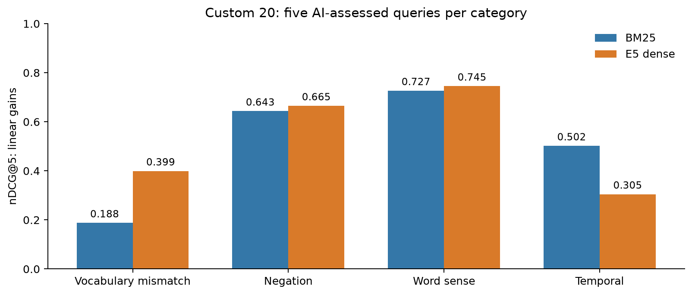
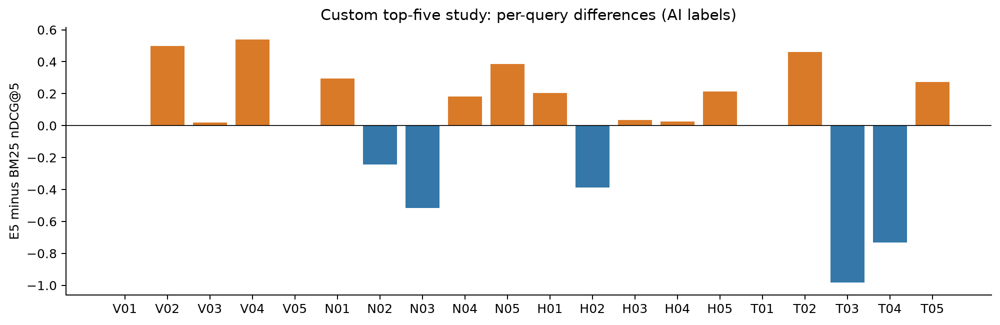

# Custom 20-query study: complete top-five assessment

> Historical milestone: current assessment status and planned human review are described in [Assessment method](ASSESSMENT_METHOD.md).

Completed on 25 October 2026: all **188 query–article pairs** in the union of both engines' top five have full-available-article AI assessments. All 20 fixed queries are represented; 100% of both engines' top-five slots are assessed. The larger depth-20 pool has **549 unassessed pairs**. This is a complete top-five analysis, not a complete pooled MAP study. Human review is planned next under the method linked above.

## Primary results

| Measure | BM25 | E5 dense |
| --- | ---: | ---: |
| nDCG@5 (linear 0–2 gains) | 0.514902 | 0.528590 |
| Precision@5 | 0.530000 | 0.530000 |
| Assessed fraction at 5 | 1.000000 | 1.000000 |

**MAP@1000 is withheld** until the designated depth-20 pool is assessed. Its eventual value will still be a shallow-pool estimate, not exhaustive corpus recall. nDCG's ideal ranking is based only on known assessed positives and may change when deeper positives are found.

Queries **V01, V05 and T01** have no positives in the assessed top-five union. They remain in the macro average with nDCG/P=0 under the declared zero-positive convention. This does not establish absence of relevant articles in the corpus or deeper pool; it flags the limits of this shallow study.

| Category (five queries each) | BM25 nDCG@5 | E5 nDCG@5 | E5 wins / BM25 wins / ties |
| --- | ---: | ---: | --- |
| Vocabulary mismatch | 0.187804 | 0.399308 | 3 / 0 / 2 |
| Negation | 0.643358 | 0.664864 | 3 / 2 / 0 |
| Word sense | 0.726768 | 0.745269 | 4 / 1 / 0 |
| Temporal | 0.501678 | 0.304918 | 2 / 2 / 1 |



## What the negation results mean

Across all five negation queries, **E5 wins three and BM25 wins two**. E5's category mean is **0.664864**, compared with **0.643358** for BM25. The earlier Ebola example (N03) is one of E5's losses, not representative evidence that BM25 generally handles negation better.

E5 is a bi-encoder: it encodes queries and articles separately for similarity matching. A high similarity score need not enforce a logical constraint. BM25 is also not a Boolean negation reasoner; its performance can benefit from exact entities, evidence wording and full-body coverage. [NevIR (Weller, Lawrie and Van Durme, EACL 2024)](https://aclanthology.org/2024.eacl-long.139/) reports substantial negation difficulty across neural retrieval architectures, including weak bi-encoder performance. That motivates a controlled test; it does not dictate which engine must win our news queries.

Full text also changes apparent polarity. N01's article with a negative headline contains Reich's empirical Seattle study finding no employment reduction, so it is relevant under the frozen mixed-article rule. Likewise, some marriage-ban stories report both restrictive and permissive decisions. We judge whether the requested evidence is present, rather than treating every contrary headline as grade 0.

## Per-query results

| ID | Category | Known pool positives | BM25 nDCG@5 | E5 nDCG@5 |
| --- | --- | ---: | ---: | ---: |
| V01 | Vocabulary mismatch | 0 | 0.000000 | 0.000000 |
| V02 | Vocabulary mismatch | 1 | 0.000000 | 0.500000 |
| V03 | Vocabulary mismatch | 8 | 0.576050 | 0.595237 |
| V04 | Vocabulary mismatch | 6 | 0.362972 | 0.901304 |
| V05 | Vocabulary mismatch | 0 | 0.000000 | 0.000000 |
| N01 | Negation | 3 | 0.469279 | 0.765361 |
| N02 | Negation | 8 | 0.696056 | 0.452315 |
| N03 | Negation | 5 | 0.660840 | 0.146068 |
| N04 | Negation | 9 | 0.777349 | 0.960575 |
| N05 | Negation | 9 | 0.613266 | 1.000000 |
| H01 | Word sense | 5 | 0.794498 | 1.000000 |
| H02 | Word sense | 1 | 0.386853 | 0.000000 |
| H03 | Word sense | 9 | 0.893007 | 0.926966 |
| H04 | Word sense | 5 | 0.773468 | 0.799380 |
| H05 | Word sense | 8 | 0.786014 | 1.000000 |
| T01 | Temporal | 0 | 0.000000 | 0.000000 |
| T02 | Temporal | 7 | 0.307440 | 0.767202 |
| T03 | Temporal | 4 | 0.982892 | 0.000000 |
| T04 | Temporal | 3 | 0.732829 | 0.000000 |
| T05 | Temporal | 6 | 0.485229 | 0.757386 |



## Uncertainty and validation

E5 wins **12** queries, BM25 wins **5**, and **3** tie. Mean E5-minus-BM25 nDCG is **+0.013688**; the descriptive paired 95% bootstrap interval is **[-0.166230, +0.178314]**, including zero (10,000 draws, seed 20261025). The suite is small, some needs overlap, and the preliminary reference awaits the planned human-review stage. No general winner is established.

The label distribution is **0: 91, 1: 30, 2: 67**; confidence is **high: 164, medium: 24**. Confidence is the assessor's own rating, not calibration. For an additional robustness check, every medium-confidence label was allowed to take every possible grade 0/1/2 within its query, while high-confidence labels stayed fixed. These extreme scenarios give an overall difference range of **[-0.122492, +0.152397]**. This is not a statistical interval or a replacement judgment set; the stored decisions were not changed. `grade_uncertainty.json` provides per-query bounds.

All **168** independent native `trec_eval` nDCG@5/P@5 comparisons passed for both engines under linear and exp2 gains. Exact quotation offsets, content hashes, pair uniqueness and pool membership validate for all 188 decisions. Original data, original 57-query qrels/runs and the earlier 16-pair pilot are preserved.

## Content quality and coverage

| Top-five slots across 20 queries | BM25 | E5 dense |
| --- | ---: | ---: |
| Total ranked slots | 100 | 100 |
| Empty-body slots | 0 | 18 |
| Body shorter than 200 characters, including empty | 0 | 20 |
| Additional identical-content slots within query | 5 | 9 |

These are descriptive diagnostics. Both baselines continue to search the same eligible corpus; title-only documents were retained in the original preprocessing. No result was silently filtered or deduplicated. Exact-content duplication occurs in both engines and is separate from semantic reasoning.

The exact pinned-tokenizer audit finds **141 of 188** assessed records truncated by E5's 512-token passage budget, with **18** empty-body pairs. `evidence_visibility.top5.json` records visibility of each quoted evidence span. BM25 indexes full bodies; visibility is an input-coverage measure, not attention or a causal explanation of scoring.

A fresh offline CPU search of the full dense index reproduced **the exact same five IDs in the same order** for H02: five identical `Results` titles with empty bodies. The maximum absolute score difference from the saved Kaggle run was 1.79e-7. This reproduces the surprising pattern independently of the cloud export; it does not by itself establish the internal cause. The local search took about 37.2 seconds including query encoding and FAISS IPC/search, excluding startup and article lookup; it is not a controlled latency benchmark. Raw output is saved at `artifacts/analysis/custom20-top5/local_h02_search.json`.

Temporal judgments use the inclusive windows in the frozen suite. Relative event dates are accepted when anchored by explicit narrative timing and the named event in the query; the rationale states the derivation. Several grade-0 records are topically relevant but lack enough text to verify the window. Such grades express failure of the evidence requirement, not proof that the actual historical event was outside the window. No dates were inferred from UUIDs or an assumed publication date. Review medium-confidence date bounds before treating temporal scores as definitive.

## Reproduce and continue

```sh
.venv/bin/python scripts/evaluate_custom_top5.py --output artifacts/evaluations/custom20-top5-rechecked
.venv/bin/python scripts/report_custom_top5.py
.venv/bin/python -m pytest -q
```

The report reads the canonical evaluation; evaluator outputs are versioned and refuse overwrites. The assessment appendix links every decision to exact stored evidence. The next required stage is the remaining 549 depth-20 candidates, followed by pooled MAP and the comparison demo. A later controlled negation minimal-pair test and a symmetric content-quality/deduplication ablation can help isolate causes; neither has been applied to these scores.
