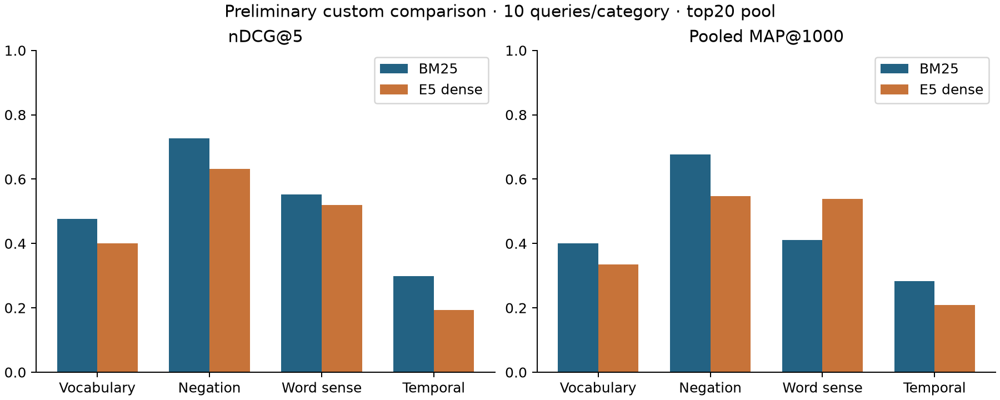

# Expanded custom study: completed 40-query evaluation

40 information needs, ten per category; 1,444 evidence-backed preliminary judgments. [Assessment method and planned human review](ASSESSMENT_METHOD.md): full-article AI judgments support the current comparison; human review is the next validation stage and has not yet been completed. The 20 follow-up needs were frozen before their retrieval, after initial results were known.

| Evaluation set | BM25 nDCG@5 | E5 nDCG@5 | BM25 MAP | E5 MAP |
| --- | --- | --- | --- | --- |
| Original 57 supplied qrels | 0.3975 | 0.4576 | 0.2329 | 0.2765 |
| Initial custom 20 | 0.4621 | 0.4897 | 0.4006 | 0.4683 |
| Added custom 20 | 0.5645 | 0.3828 | 0.4849 | 0.3460 |
| Combined custom 40 | 0.5133 | 0.4362 | 0.4428 | 0.4072 |

| Category (10 each) | BM25 nDCG@5 | E5 nDCG@5 | BM25 MAP | E5 MAP |
| --- | --- | --- | --- | --- |
| Vocabulary mismatch | 0.4757 | 0.4000 | 0.4007 | 0.3343 |
| Negation | 0.7270 | 0.6322 | 0.6767 | 0.5469 |
| Word sense | 0.5526 | 0.5198 | 0.4113 | 0.5389 |
| Temporal | 0.2980 | 0.1930 | 0.2823 | 0.2085 |

BM25 leads the expanded means; this reverses the initial sample. All query/family bootstrap intervals include zero. Scores were computed from saved rankings and graded evidence; original queries and 737 decisions remain unchanged. Custom MAP uses shallow pooled positives.

| ID | BM25 nDCG@5 | E5 nDCG@5 | BM25 pooled AP | E5 pooled AP |
| --- | --- | --- | --- | --- |
| V01 | 0.000000 | 0.000000 | 0.026907 | 0.216759 |
| V02 | 0.000000 | 0.306574 | 0.031250 | 0.170651 |
| V03 | 0.576050 | 0.595237 | 0.391512 | 0.595657 |
| V04 | 0.339160 | 0.842176 | 0.182881 | 0.831729 |
| V05 | 0.000000 | 0.000000 | 0.000000 | 0.000000 |
| N01 | 0.469279 | 0.765361 | 0.370707 | 0.791667 |
| N02 | 0.650393 | 0.422642 | 0.692176 | 0.451573 |
| N03 | 0.660840 | 0.146068 | 0.749678 | 0.157046 |
| N04 | 0.669580 | 0.827404 | 0.875064 | 0.687599 |
| N05 | 0.573034 | 0.934397 | 0.773601 | 0.616652 |
| H01 | 0.684352 | 0.861363 | 0.239408 | 0.984642 |
| H02 | 0.084477 | 0.000000 | 0.244525 | 0.175653 |
| H03 | 0.893007 | 0.926966 | 0.794312 | 0.899023 |
| H04 | 0.722727 | 0.746939 | 0.390662 | 0.845497 |
| H05 | 0.786014 | 1.000000 | 0.413685 | 0.573233 |
| T01 | 0.000000 | 0.000000 | 0.086891 | 0.107490 |
| T02 | 0.264817 | 0.660840 | 0.281999 | 0.471145 |
| T03 | 0.853932 | 0.000000 | 0.646269 | 0.096919 |
| T04 | 0.529635 | 0.000000 | 0.484782 | 0.063138 |
| T05 | 0.485229 | 0.757386 | 0.335692 | 0.630293 |
| V06 | 0.830420 | 0.508740 | 0.841361 | 0.430449 |
| V07 | 0.315648 | 0.339160 | 0.490035 | 0.159079 |
| V08 | 0.926966 | 0.300785 | 0.733579 | 0.225697 |
| V09 | 0.915210 | 0.723427 | 0.635734 | 0.539493 |
| V10 | 0.853932 | 0.383566 | 0.674178 | 0.173754 |
| N06 | 1.000000 | 0.529635 | 0.717910 | 0.459031 |
| N07 | 1.000000 | 0.893007 | 0.826729 | 0.825147 |
| N08 | 0.868795 | 0.595237 | 0.596635 | 0.552270 |
| N09 | 0.786014 | 0.654809 | 0.601272 | 0.571473 |
| N10 | 0.592222 | 0.553146 | 0.563318 | 0.356583 |
| H06 | 0.868795 | 0.684352 | 0.750505 | 0.431198 |
| H07 | 0.325074 | 0.319394 | 0.362500 | 0.358974 |
| H08 | 0.229010 | 0.000000 | 0.207330 | 0.065031 |
| H09 | 0.616434 | 0.446854 | 0.520083 | 0.684390 |
| H10 | 0.315648 | 0.211671 | 0.189949 | 0.371474 |
| T06 | 0.500000 | 0.000000 | 0.333333 | 0.016393 |
| T07 | 0.106993 | 0.131205 | 0.180638 | 0.267470 |
| T08 | 0.000000 | 0.380094 | 0.001534 | 0.309524 |
| T09 | 0.000000 | 0.000000 | 0.138393 | 0.067372 |
| T10 | 0.239812 | 0.000000 | 0.333333 | 0.055411 |

See `annotations/custom40_v2/assessment_completion.json`, `adjudication.json`, `assessments.all40.jsonl`, and `artifacts/evaluations/custom40-depth20-v2/`. Original-20 quality ablations are preserved separately; no expanded ablation is claimed.

