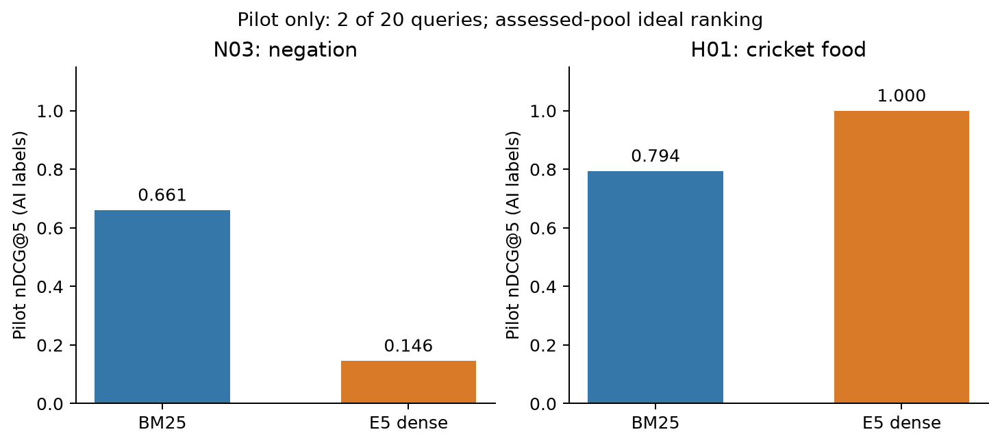

# Custom query AI assessment: calibration pilot

> Historical milestone: current assessment status and planned human review are described in [Assessment method](ASSESSMENT_METHOD.md).

**Two of 20 queries, 16 of 737 pooled pairs assessed.** The assistant read every available title and full body for these 16 records and stored a grade, confidence, rationale, exact source quotations and character offsets. Two records have empty bodies: full reading means all available corpus content, not recovery of missing original text. These full-article AI judgments support preliminary comparison; human review is planned next under the method linked above.

The user explicitly authorized assistant assessment. The fixed 20-query wording, rubric and inclusive event windows are copied byte-for-byte from the pre-existing draft. Historical draft/human-review status remains in that source snapshot; the new protocol authorizes AI assessment. Human approval fields are blank. The protocol was recorded after retrieval and initial H01 inspection, so no preregistration or perfect assessor blindness is claimed.

The equal-depth pool unions top 20 from each full-corpus engine: **737 pairs**, with **188** in either top five. Article packets omit engine/rank/score and use deterministic hash order. All stored evidence spans validate exactly against their article hashes. Unresolved judgments remain unassessed rather than becoming grade 0.

| Query | BM25 nDCG@5 | E5 nDCG@5 | BM25 P@5 | E5 P@5 |
| --- | ---: | ---: | ---: | ---: |
| N03 | 0.660840 | 0.146068 | 0.80 | 0.20 |
| H01 | 0.794498 | 1.000000 | 0.60 | 1.00 |

Both engines have 100% assessed top-five coverage for these two queries. Primary nDCG uses linear 0–2 gains; the ideal ranking is drawn from assessed positives and can change with deeper assessment. The earlier blueprint proposed exp2 gains; current primary gains align with the original benchmark, and exp2 sensitivity is also saved in `metrics.pilot.json`. **MAP is withheld while the designated pool remains incomplete.** A two-query pilot average is not a 20-query result.

## N03: Find reporting explaining that Ebola is NOT airborne and describing the direct-contact conditions through which transmission occurs.

| Engine | Rank | Grade | Article ID |
| --- | ---: | ---: | --- |
| BM25 | 1 | 0 | `dbb46f6240ef188add6c6cf14b5e2acf` |
| BM25 | 2 | 2 | `6e21bdec-561b-11e4-809b-8cc0a295c773` |
| BM25 | 3 | 2 | `8583b3abb035814a1f2092d0931ac962` |
| BM25 | 4 | 2 | `685a196d46f057a0548aa904ab451a13` |
| BM25 | 5 | 2 | `d763fe26adcbd9cfbe98c23aeef590ae` |
| E5 dense | 1 | 0 | `48ba826e85ce81d1399fc6636b1e8c23` |
| E5 dense | 2 | 0 | `dfc2d87759ec4d6f170771742f2e88e4` |
| E5 dense | 3 | 0 | `e0101e6090b91d47c31b38f2fa5b6aaf` |
| E5 dense | 4 | 2 | `a8389b1f22a913eb987ceea3f4716d67` |
| E5 dense | 5 | 0 | `dbb46f6240ef188add6c6cf14b5e2acf` |

**Observed:** BM25 retrieves four articles with explicit requested negative statements plus contact explanations, but its rank-one article fails that constraint. E5 puts an opposite-polarity headline stub first and two one-word, empty-body `ebola` records second and third; those two IDs have identical available content. Its fourth result satisfies the need, while its fifth is the same failing article as BM25 rank one. This mixes constraint failure, sparse content and duplicate content; it does not isolate negation as the sole cause. Grade 0 means failure to satisfy this information need, not a judgment about current medical truth.

## H01: Find reporting on cricket farming for human food, including nutritional benefits or environmental costs.

| Engine | Rank | Grade | Article ID |
| --- | ---: | ---: | --- |
| BM25 | 1 | 2 | `93c510bebbb8f9a0a57eb28aa54f47aa` |
| BM25 | 2 | 2 | `e1fd11fc-9f94-11e6-8832-23a007c77bb4` |
| BM25 | 3 | 0 | `776ad970-2769-11e2-b4f2-8320a9f00869` |
| BM25 | 4 | 0 | `47c460ee-3a72-11e7-9e48-c4f199710b69` |
| BM25 | 5 | 2 | `109e66bca6a8cce1e7418b08a4b442e2` |
| E5 dense | 1 | 2 | `93c510bebbb8f9a0a57eb28aa54f47aa` |
| E5 dense | 2 | 2 | `109e66bca6a8cce1e7418b08a4b442e2` |
| E5 dense | 3 | 2 | `e1fd11fc-9f94-11e6-8832-23a007c77bb4` |
| E5 dense | 4 | 1 | `308441f54df1e4903dcaec2249706824` |
| E5 dense | 5 | 1 | `c8a6a344-bd7a-11e2-89c9-3be8095fe767` |

**Observed:** E5 retrieves cricket-food reporting throughout its top five. BM25's ranks 3–4 instead discuss organic/conventional crops and oats. Their farming, environmental and nutrition vocabulary fits parts of the query but the mandatory cricket-food entity is missing. Two E5 articles receive only grade 1 because their nutrition/environmental support is brief or generic. This is an observed topic-focus difference, not proof of an internal reasoning mechanism.

## Evidence visibility and next experiments

The exact local tokenizer audit finds **10 of 16** pilot records are truncated by the 512-token E5 budget and **2** have empty bodies. `annotations/ai_study_v1/evidence_visibility.pilot.json` records whether each saved evidence span is wholly visible in the actual passage-prefixed input. This measures input availability, not attention or causal importance.

Next: complete top-five judgments for the remaining 18 queries, then assess the remaining depth-20 pool and evaluate pooled MAP@1000 with coverage disclosures. Keep the same wording regardless of which engine wins. Useful later ablations are constraint-flip query pairs, removal of empty/near-empty records for both engines, content deduplication, and passage coverage. Each needs separate runs and compatible labels; none is silently applied to these baselines.

AI-assessment limitation: [Ian Soboroff (2025), Don't Use LLMs to Make Relevance Judgments](https://tsapps.nist.gov/publication/get_pdf.cfm?pub_id=958495). Assistant labels enable an exploratory study but do not establish human agreement or unbiased system preference.
