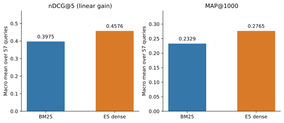
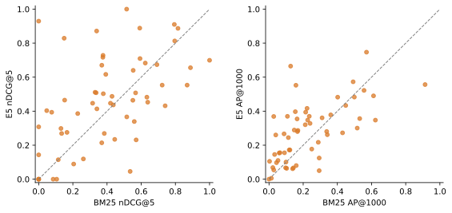
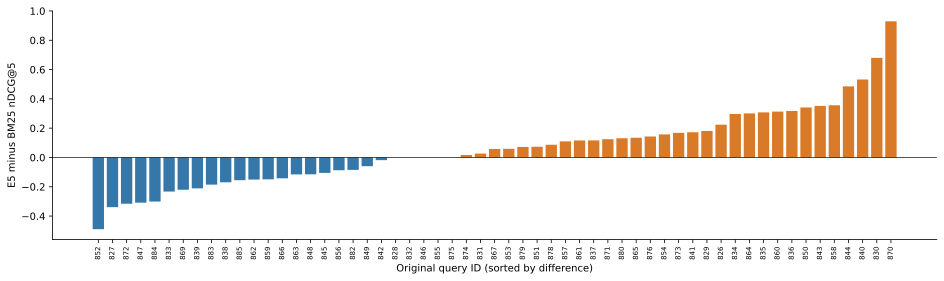
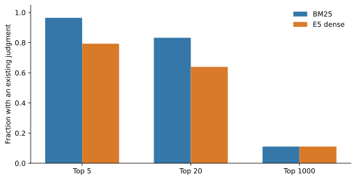

# Original 57-query benchmark: BM25 versus E5 dense retrieval

Completed on 24 October 2026. Both engines retrieved the top 1,000 articles for each original query from the same **594,589-document** corpus. Evaluation uses all **15,655 supplied judgments**. This is the original headline/background-linking benchmark; the separate 20-query challenge suite remains deferred.

## Main results

| Metric | BM25 | E5 dense | E5 minus BM25 |
| --- | ---: | ---: | ---: |
| nDCG@5, direct-grade gain | 0.397464 | 0.457588 | +0.060123 |
| nDCG@10, direct-grade gain | 0.362766 | 0.435806 | +0.073040 |
| MAP@1000 | 0.232874 | 0.276498 | +0.043624 |
| Recall@1000 | 0.668104 | 0.773767 | +0.105663 |
| Precision@5 | 0.529825 | 0.557895 | +0.028070 |
| MRR@1000 | 0.677036 | 0.757328 | +0.080292 |

E5 has higher averages on this query set, while performance varies by query. These measurements do not establish that dense retrieval always outperforms BM25 or that every LLM has these capabilities.



## Paired query analysis

| Metric | Dense wins | Ties | BM25 wins | Mean difference | Paired bootstrap 95% interval |
| --- | ---: | ---: | ---: | ---: | --- |
| nDCG@5 | 31 | 5 | 21 | +0.060123 | [-0.004629, +0.129424] |
| AP@1000 | 36 | 0 | 21 | +0.043624 | [+0.003196, +0.085179] |

Intervals use 10,000 paired query resamples with seed 20261024. The nDCG@5 interval includes zero; its average advantage is uncertain at this interval level. The AP difference interval is positive for this resampling analysis. These are descriptive percentile intervals, conditional on the supplied judgments and query-independence assumption, rather than broad population guarantees.





## Evaluation definitions

The primary nDCG gain equals the supplied relevance grade (0–4), with discount `1/log2(rank+1)`. The ideal ranking uses every original judgment, including unavailable positive documents. This direct-grade convention follows [BEIR's evaluator](https://github.com/beir-cellar/beir/blob/main/beir/retrieval/evaluation.py) and [trec_eval's ndcg_cut implementation](https://github.com/usnistgov/trec_eval/blob/main/m_ndcg_cut.c).

AP treats grade > 0 as relevant, sums precision at each relevant hit within the 1,000 saved ranks, and divides by **all** known relevant articles for that query. MAP@1000 is the macro mean over all 57 queries. Unjudged articles contribute zero gain/relevance while retaining their rank positions; this convention does not establish that they are actually irrelevant. See [trec_eval's map_cut definition](https://github.com/usnistgov/trec_eval/blob/main/m_map_cut.c).

## Sensitivity to gain convention and unavailable articles

| Policy | BM25 nDCG@5 | E5 nDCG@5 | BM25 MAP@1000 | E5 MAP@1000 |
| --- | ---: | ---: | ---: | ---: |
| Primary: supplied grades, all qrels | 0.397464 | 0.457588 | 0.232874 | 0.276498 |
| Gain 2^grade - 1, all qrels | 0.336885 | 0.395883 | 0.232874 | 0.276498 |
| Original NIST gains 0/2/4/8/16 | 0.354580 | 0.411801 | 0.232874 | 0.276498 |
| Available-corpus sensitivity, linear gain | 0.397464 | 0.458154 | 0.233045 | 0.276907 |

There are **65 judgments** referring to **57 unique unavailable articles**, including **3 positive judgments**. The primary results retain them. The available-corpus row removes only those judgments from the reference set and reuses the exact same rankings.

## Judgment coverage

| Retrieved slice | BM25 judged | E5 judged |
| --- | ---: | ---: |
| Top 5 | 96.49% | 79.30% |
| Top 10 | 91.23% | 73.16% |
| Top 20 | 83.25% | 63.95% |
| Top 1000 | 11.09% | 11.11% |

E5's top-ranked results have lower existing judgment coverage. An unjudged result may be useful, so these metrics measure performance against this incomplete reference set. This particularly limits strong failure claims based on E5's unjudged articles.



## Provenance and independent verification

All 15,655 query-document pairs match the [official NIST qrels](https://trec.nist.gov/data/news/2019/newsir19-qrels-background.txt). The supplied grade mapping is 0 → 0 and positive grade g → 2^g in NIST's gain-valued file. Official topic metadata has 60 topics, of which the supplied 57 have judgments here. None of their canonical source articles occurs in the local corpus. The topic/grade audit is recorded in `artifacts/original_benchmark_provenance.json`; see the [NIST data page](https://trec.nist.gov/data/news2019.html).

The native trec_eval implementation bundled with Anserini independently checks all per-query and aggregate nDCG@5/10, MAP@1000, Recall@1000, Precision@5/10 and reciprocal-rank values for both engines under all four policies. Agreement tolerance is 0.000051 because native output is rounded to four decimals. A derived ordinal-score run preserves the submitted rank order when native trec_eval resolves ties; the original model scores and runs are preserved. Hand-calculated fixtures, empty-query behavior, missing-positive denominators, invalid-label rejection and atomic publication are also tested.

## Measured examples

| Query | Short description | BM25 nDCG@5 | E5 nDCG@5 |
| --- | --- | ---: | ---: |
| 870 | Seven transgender women have been killed this year. Democrats want Jeff Sessions to investigate. | 0.0000 | 0.9294 |
| 830 | Scientists discover new frog species small enough to sit on a fingernail | 0.1491 | 0.8289 |
| 852 | Why the FDA’s new e-cigarette regulations are a gift to Big Tobacco (and could actually harm public health) | 0.5353 | 0.0457 |
| 827 | House panel probes drug distributors and DEA amid national opioid crisis | 0.5703 | 0.2312 |

See [ORIGINAL_57_CASE_STUDIES.md](ORIGINAL_57_CASE_STUDIES.md) for the top-five articles, supplied grades and source excerpts. These are selected extreme cases, not a representative random sample.

## Scope and limitations

- This is the downloaded headline/background-linking adaptation; it is not the 20-query linguistic stress study or a full official TREC reproduction.
- BM25 reads full article bodies. E5 receives the beginning within 512 total tokens, including its prefix and special tokens. This input-coverage difference is a confound.
- No publication-date or near-duplicate-cluster filters were implemented. The corpus lacks the metadata needed to reproduce all original task rules reliably.
- Fixed BM25/model settings were evaluated without tuning on these qrels. No relevance labels were generated or changed.
- Both runs used the local Mac, but retrieval overlapped development/testing and memory pressure on an 8 GiB machine. Saved latencies are operational observations, not a controlled speed comparison.
- Higher aggregate scores do not demonstrate robustness to negation, ambiguous senses or explicit temporal constraints. Those claims require the deferred custom study.

## Reproduce and inspect

```sh
.venv/bin/news-ir run --queries queries.jsonl --output artifacts/runs/bm25-original-reproduced --top-k 1000
.venv/bin/news-ir run --engine dense --queries queries.jsonl --output artifacts/runs/dense-original-reproduced --top-k 1000 --device cpu
.venv/bin/news-ir evaluate --bm25-run artifacts/runs/bm25-original-reproduced --dense-run artifacts/runs/dense-original-reproduced --output artifacts/evaluations/original-57-reproduced
.venv/bin/python scripts/report_original_benchmark.py
```

Existing run/evaluation directories are never silently overwritten. The report script regenerates figures and report text from `artifacts/evaluations/original-57/`.

Machine-readable results: `metrics.json`, `per_query.csv`, `paired_comparison.json`, `crosscheck.json`, `unavailable_judgments.json` and `manifest.json` in that evaluation directory. Standalone SVG, PDF and PNG plots are under `reports/figures/original-57/`.
