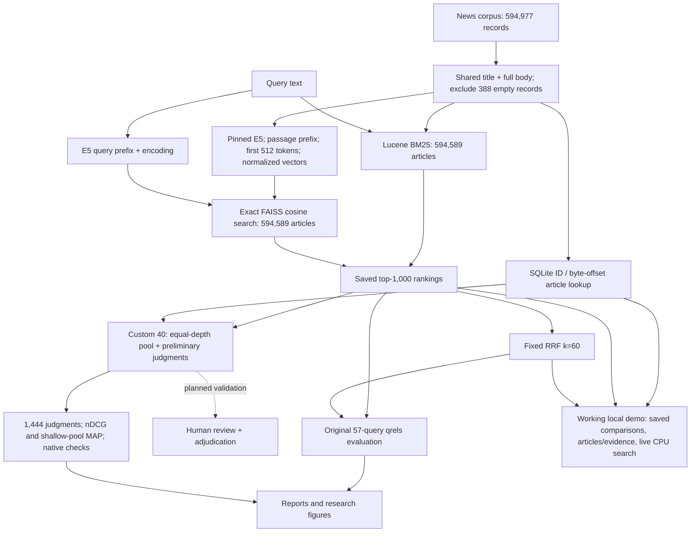

# Interim submission checklist

The four-page brief and 19-page supporting research report are generated and published with the public GitHub link. The custom comparison uses thorough, full-article AI judgments as a preliminary reference; human review is planned next and has not yet been completed. See [assessment method and review plan](ASSESSMENT_METHOD.md) and `DELIVERABLES.md` for the current package.

| Required object | Current status | Evidence / remaining action |
| --- | --- | --- |
| Single PDF, at most four pages | Generated and verified: 4 pages | `deliverables/5_NewsIR_BM25_Dense.pdf`; metadata filled; confirm individual attribution before upload |
| Filename `<GroupNo>_<ShortProjectTitle>.pdf` | Filled | `5_NewsIR_BM25_Dense.pdf`; four pages verified |
| Group number, title, all member names | Filled | Group 5; all four supplied names/IDs; Information Retrieval; mentor Abhinav Kumar |
| GitHub repository link | Public; created and verified | `https://github.com/parthRag/news-ir-bm25-dense-final`; source, notebooks and reports published |
| Basic README | Present | Root `README.md`, commands, setup, results and limitations |
| Implementation status and architecture | Present in Markdown | `TASK_G_FINAL_DELIVERABLES.md`, the PDFs and diagram below; comparison interface and custom evaluation complete |
| Executed preprocessing and retrieval details | Present | README, Task A/B/C reports; pinned E5 revision and no stemming/stopword removal documented |
| Preliminary evaluation against baseline | Present | BM25/E5/RRF original 57; BM25/E5 custom 40 with complete 1,444-pair pool, nDCG and pooled MAP; category and uncertainty figures |
| Memory and time requirements | Partly measured | Index disk sizes and build/encoding/search timings available; controlled peak RAM and end-to-end hybrid latency not measured |
| Remaining-work plan | Present | Quality ablation, paper and four-page PDF complete; remaining work is planned human review, individual attribution confirmations and rehearsal |
| Stretch objective status | Present | RRF complete; visibility audit complete for 1,444 pairs; content-quality and grade-sensitivity analyses complete; symmetric quality ablation complete; controlled polarity flips deferred |
| Contribution matrix | Component roles assigned; individual work partly confirmed | All four members have component responsibilities; individual work recorded only where confirmed |
| One member submits | User action at submission | Submit one final PDF from the selected group member |

## Current architecture

BM25 sees full article text; E5 retains a 512-token prefix. This coverage difference is disclosed and audited rather than described as identical model input. Both engines search the same eligible document set. FAISS runs in an isolated process on the Mac to avoid OpenMP conflicts.

## Resource evidence for the eventual PDF

| Measurement | Current evidence | Interpretation limit |
| --- | --- | --- |
| BM25 index folder | 385,483,844 bytes, including article metadata | Disk size, not RAM |
| Dense index folder | 1,848,335,569 bytes | Disk size, not model weights or RAM |
| E5 model weights | About 418 MiB | Additional to the vector index |
| BM25 build | About 66.55 seconds on local Mac | Hardware/stage differs from encoding |
| Full dense job | About 5h43m on one Kaggle T4 | Encoding job completed; not query latency |
| Saved-rank fusion | About 0.69 ms/query | Excludes both searches, file loading and startup |
| Live search timing | Saved run manifests document protocols | Mac memory pressure prevents a controlled speed comparison claim |
| Demo smoke search | BM25 1.39 s; E5 48.59 s including process/model startup | One CPU query, not a controlled latency benchmark; full live job about 50 s plus browser polling |
| Peak RAM | Not measured under a controlled protocol | Do not substitute index disk size |

## Contribution matrix

The current four-member matrix is in `configs/submission.json`, `deliverables/contribution_matrix.csv` and the generated PDFs. `CONTRIBUTING.md` lists component responsibilities and how to document actual completed work.

## Original proposal requirements

The latest four-page report also covers the original proposal checklist: primary objective, evaluation criteria, linked dataset, full related-paper titles/links and findings, approach/architecture with reasoning, key innovations, stretch work, and milestone/timeline estimates. See `FOUR_PAGE_REQUIREMENTS_REVIEW.md` for the page-by-page mapping and accuracy checks. The user requests four pages within the quoted six-page maximum.
